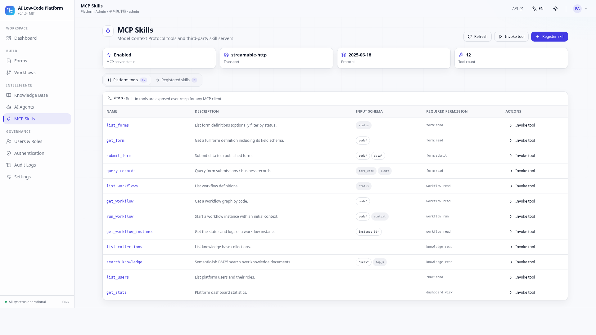

# AI Low-Code Platform

> An AI-native, full-stack low-code platform: visual **form designer**, visual **DAG workflow orchestration**, a complete **REST API**, **MCP** (streamable HTTP) with third-party skills, knowledge-grounded **AI query & action agents**, full **RBAC**, **CAS / OAuth2 / OIDC / WeCom / DingTalk SSO**, and role/user-based **Passkey + OTP MFA**.

Frontend: **Vite + React + TypeScript + shadcn/ui design system** · Backend: **uv + python-dotenv + FastAPI + fastmcp + AgentScope** · **MIT licensed** · **i18n (en/zh, English by default)** · **theme (system / light / dark)**.

中文文档：[README.zh-CN.md](README.zh-CN.md) · Backend: [backend/README.md](backend/README.md) ([中文](backend/README.zh-CN.md)) · Frontend: [frontend/README.md](frontend/README.md) ([中文](frontend/README.zh-CN.md))

---

## Screenshots

| Dashboard | Form Designer |
| --- | --- |
|  |  |

| Workflow Studio | AI Agents |
| --- | --- |
|  |  |

| Knowledge Base (RAG) | MCP Skills | Users & Roles | Dark theme |
| --- | --- | --- | --- |
|  |  |  |  |

---

## Features

| Area | What is implemented |
| --- | --- |
| **Visual form designer** | 15 field types, click-to-add palette, drag-to-reorder, per-field property editor (label/key/required/placeholder/options/width/validation), live preview with real validation, draft/publish/archive, submission records |
| **Visual workflow orchestration** | Drag-and-drop DAG canvas with bezier edges, 9 node types (start/end/form/condition/approval/AI/knowledge/HTTP/notification), connect mode, condition branches, node config panel, zoom, auto-layout, graph validation (cycle detection), execution engine, instance logs |
| **REST API** | ~70 versioned endpoints under `/api/v1`, Pydantic request/response models, auto OpenAPI at `/docs`, consistent error codes, audit logging on every mutation |
| **MCP** | Real `fastmcp` streamable-HTTP server at `/mcp` (initialize / tools/list / tools/call / resources / prompts), 12 platform tools, plus a dependency-free built-in JSON-RPC fallback; registry for third-party `http`/`sse`/`stdio` MCP servers with tool sync and REST invocation |
| **AI agents** | `query` / `act` / `hybrid` agents, AgentScope-compatible ReAct tool loop, RAG grounding, conversation persistence, source citations, visible tool-call steps; `mock` / `openai-compatible` / `agentscope` LLM backends (works offline by default) |
| **Knowledge base** | Collections, documents, automatic chunking, mixed zh/en BM25 retrieval (unigram+bigram), assembled RAG context, retrieval test console |
| **RBAC** | Users, roles, 25 fine-grained permissions, role×permission matrix, per-endpoint `Depends(require("x:y"))` enforcement, built-in admin/developer/operator/viewer roles |
| **SSO** | CAS, OAuth2, OIDC (discovery + ID token), WeCom (企业微信), DingTalk (钉钉) — configurable from the UI, with a clearly flagged demo mode so the whole redirect → callback → user-provisioning flow works without credentials |
| **MFA** | TOTP/OTP (RFC 6238, real 6-digit verification + otpauth QR), WebAuthn/Passkey registration & authentication, policy enforcement **globally / per role / per user**, enrollment flow at login |
| **UI/UX** | shadcn/ui-style component library, consistent layout, animated light/dark backgrounds, mobile-first responsive shell, i18n en/zh (default en), theme system/light/dark following the OS, no emoji (SVG icons only) |

---

## Architecture

```
ai-lowcode-platform/
├── backend/                    FastAPI application (uv, python-dotenv)
│   ├── app/
│   │   ├── main.py             app factory, SPA hosting, MCP ASGI mount, lifespan
│   │   ├── config.py           env-driven settings
│   │   ├── db.py               SQLite data access (JSON columns, WAL)
│   │   ├── security.py         JWT HS256, PBKDF2, TOTP, WebAuthn challenges, MFA policy
│   │   ├── deps.py             auth / RBAC dependencies, audit helper
│   │   ├── seed.py             deterministic bootstrap data
│   │   ├── mcp_server.py       fastmcp tools + builtin JSON-RPC fallback
│   │   ├── routers/            auth, rbac, forms, workflows, knowledge, agents, mcp, audit, meta
│   │   └── services/           workflow_engine, rag, llm, mcp_tools, sso
│   └── tests/smoke.py          47 end-to-end API assertions
└── frontend/                   Vite + React + TS SPA
    └── src/
        ├── components/ui/      shadcn-style primitives, dialogs, toasts, table
        ├── components/layout/  AppShell (sidebar, header, theme/locale switches)
        ├── i18n/               en/zh dictionaries + provider
        ├── theme/              ThemeProvider (system/light/dark)
        ├── store/              AppContext (session, bootstrap catalogs, permissions)
        ├── lib/                api client, utils, WebAuthn helpers
        └── pages/              11 pages incl. form designer & workflow canvas
```

**One registry, three consumers.** `services/mcp_tools.py` declares every platform capability once (name, JSON Schema, permission). The MCP server, the AI agents' tool loop and the REST `/mcp/invoke` endpoint all call the same handlers — so an agent can genuinely submit a form or run a workflow, not just talk about it.

**Auth flow.** `POST /auth/login` → JWT, or an MFA challenge when a global/role/user policy applies. SSO callbacks provision local users automatically. Every API route is guarded by an RBAC dependency; MCP requests may carry the same bearer token through a pure-ASGI middleware.

---

## Quick start

Prerequisites: **Python 3.11+**, **Node 18+**, `uv`, `pnpm`.

```bash
git clone <your-repo> && cd ai-lowcode-platform
chmod +x scripts/*.sh
./scripts/setup.sh           # uv sync + pnpm install + .env templates
./scripts/dev.sh             # backend :8000 + Vite dev :5173
```

Or single-port (production build served by FastAPI):

```bash
./scripts/start.sh           # builds frontend/dist, serves everything at http://localhost:8000
```

Open **http://localhost:5173** (dev) or **http://localhost:8000** (single port).
API docs: `/docs` · OpenAPI: `/openapi.json` · Health: `/api/v1/meta/health` · MCP: `/mcp`.

### Demo accounts

| Username | Password | Role | Access |
| --- | --- | --- | --- |
| `admin` | `admin123` | admin | everything (`*`) |
| `alice` | `demo1234` | developer | build forms, workflows, agents, knowledge |
| `bob` | `demo1234` | operator | submit forms, run workflows, chat |
| `carol` | `demo1234` | viewer | read-only |

The database is created and seeded automatically on first boot. CAS ships enabled in **demo mode** — click it on the login page to exercise the complete SSO flow.

---

## Try it in 5 minutes

1. **Forms** → open `leave_request` → edit a field in the property panel → switch to **Preview** → fill & submit → view submissions.
2. **Workflows** → open `leave_approval` → drag a node, use **Connect** to add an edge → **Validate** → **Run** with `{"days": 5}` → inspect the condition branch (`true` → director approval).
3. **Knowledge Base** → run a retrieval test, e.g. `请假制度 leave policy` → see BM25 hits and the assembled context.
4. **AI Agents** → open *AI Copilot* → ask `List all forms and show platform statistics` → watch real tool calls with results; ask `What is the leave policy?` for a grounded answer with citations.
5. **MCP Skills** → browse the 12 platform tools → **Invoke** one over REST → **Sync tools** on a registered server.
6. **Authentication** → enable an SSO provider, edit the MFA policy (enforce OTP for a role), then **Settings** → enroll OTP with a QR code or add a passkey.
7. Toggle **EN/中文** and the theme (system/light/dark) in the header.

Deep links are supported: `/#/forms?form=leave_request`, `/#/workflows?workflow=leave_approval`, `/#/agents?agent=general_copilot`.

---

## API & MCP highlights

| Endpoint | Purpose |
| --- | --- |
| `POST /api/v1/auth/login`, `/auth/mfa/verify`, `/auth/otp/*`, `/auth/passkey/*`, `/auth/sso/*` | Authentication, MFA, SSO |
| `/api/v1/forms`, `/workflows`, `/knowledge`, `/agents`, `/mcp`, `/rbac`, `/audit`, `/settings`, `/meta` | Full resource CRUD + actions |
| `POST /api/v1/workflows/{id}/validate`, `/run` | DAG validation and execution |
| `POST /api/v1/knowledge/search`, `/agents/{id}/chat` | RAG retrieval and ReAct agent chat |
| `GET /api/v1/meta/bootstrap` | All UI catalogs (field types, node types, permissions, providers, runtime) in one call |
| `POST /mcp` | MCP streamable HTTP (`initialize`, `tools/list`, `tools/call`, `resources/*`, `prompts/*`) |

MCP tools: `list_forms`, `get_form`, `submit_form`, `query_records`, `list_workflows`, `get_workflow`, `run_workflow`, `get_workflow_instance`, `list_collections`, `search_knowledge`, `list_users`, `get_stats`.

Any MCP client can connect to `http://localhost:8000/mcp`. Optionally send `Authorization: Bearer <token>` so tool calls are RBAC-checked.

---

## Configuration

Copy `backend/.env.example` to `backend/.env`. Key settings:

| Variable | Default | Notes |
| --- | --- | --- |
| `SECRET_KEY` | dev-only | **Change in production** (JWT HS256 signing) |
| `DB_PATH` | `./data/platform.db` | SQLite file |
| `LLM_PROVIDER` | `mock` | `mock` (offline) / `openai-compatible` / `agentscope` |
| `LLM_API_KEY`, `LLM_BASE_URL`, `LLM_MODEL` | — | needed only for real LLM calls |
| `MFA_REQUIRED`, `MFA_ENFORCED_ROLES`, `MFA_ENFORCED_USERS` | off | MFA policy (also editable in the UI) |
| `PASSKEY_RP_ID`, `PASSKEY_ORIGIN` | localhost | WebAuthn relying party |
| `CAS_*`, `OAUTH2_*`, `OIDC_*`, `WECOM_*`, `DINGTALK_*` | — | SSO credentials (also editable in the UI) |
| `MCP_EXTERNAL_SERVERS` | — | optional third-party MCP endpoints |
| `CORS_ORIGINS` | localhost:5173 | frontend origin, also used for SSO redirects |

Frontend: `frontend/.env.example` (`VITE_API_BASE=/api/v1`, proxied to `:8000` by Vite).

---

## i18n & theme

- **English is the default**; switch to 中文 in the header (persisted in `localStorage`). All UI strings live in `frontend/src/i18n/locales.ts` (496 leaf keys per locale, verified complete).
- **Theme defaults to `system`** and follows `prefers-color-scheme`; light/dark can be forced. Design tokens are CSS HSL variables in `frontend/src/index.css`, following the shadcn/ui convention.
- Platform defaults (`default_locale`, `default_theme`, …) are also stored server-side via `/api/v1/settings`.

---

## Documentation

Full design and architecture documentation lives in [`docs/`](docs/README.md):

| Document | Covers |
| --- | --- |
| [System Architecture](docs/architecture.md) ([中文](docs/architecture.zh-CN.md)) | C4 context/container/component views, request pipeline, runtime sequences, deployment, quality attributes, traceability |
| [AI System Design](docs/ai-design.md) ([中文](docs/ai-design.zh-CN.md)) | LLM runtime & degradation, ReAct orchestration, unified tool registry, RAG/BM25, MCP exposure, prompt spec, safety boundary, production upgrade path |
| [Security Architecture](docs/security.md) | JWT/PBKDF2/TOTP/WebAuthn, 25 RBAC permissions, SSO, MFA policy, audit, threat model |
| [Data Model](docs/data-model.md) | 17 tables, 4 indexes, JSON columns, ER diagram, seed data |
| [REST & MCP API Reference](docs/api-reference.md) | All 67 OpenAPI paths, MCP methods, 12 tool schemas, examples |
| [ADR index](docs/adr/README.md) | 6 accepted architecture decision records + template |

Real UI screenshots: [`docs/screenshots/`](docs/screenshots/).

---

## Testing

```bash
cd backend
uv run --extra dev ruff check app       # lint (dev extra)
python tests/smoke.py                   # or: uv run python tests/smoke.py

cd ../frontend
pnpm typecheck && pnpm build
pnpm check:i18n                         # en/zh key parity
```

The smoke suite covers 47 assertions: auth/RBAC (including a 403 denial), form publish/validation/submit, DAG validation and both condition branches, RAG indexing, agent tool loops, MCP handshake/tools/call, SSO demo provisioning, MFA enrollment, audit logs, SPA hosting and API 404 handling.

---

## Production notes

This repository is a **complete, runnable reference implementation**. Before production use, harden the following:

- **Passkeys** use demo-grade registration (challenge binding + credential storage). Install the `webauthn` extra to enable full attestation/assertion verification; WebAuthn requires HTTPS.
- **SSO providers without credentials run in demo mode** and provision a synthetic user — configure real credentials and disable demo mode.
- **LLM defaults to `mock`** so every feature works offline; set `LLM_PROVIDER=openai-compatible` (or `agentscope`) plus an API key for real models.
- **Workflow approval/HTTP/notification nodes are simulated** by the demo engine (auto-approve, no outbound request) — plug in your task/notification services.
- Replace SQLite with PostgreSQL for multi-instance deployments, set a strong `SECRET_KEY`, enable HTTPS, and enforce MCP authentication for untrusted clients.

---

## License

[MIT](LICENSE) © 2026 AI Low-Code Platform Team
