# AI Low-Code Platform

> An AI-native, full-stack low-code platform: a **China-localized visual form designer** (44 field types, statutory validators, formula sandbox, detail tables, conditional rules), visual **DAG workflow orchestration** with a **long-running human approval runtime** (countersign, parallel/join, delegation, task actions), a complete **REST API**, **MCP** (streamable HTTP) with **independently managed MCP servers and Skills**, multi-category **AI model services** (LLM/ASR/TTS/Embedding/Rerank/Vision), **multi-format knowledge upload** (Office/PDF/Markdown/…), knowledge-grounded **AI query & action agents** with declarative resource bindings, full **RBAC**, **CAS / OAuth2 / OIDC / WeCom / DingTalk SSO**, and role/user-based **Passkey + OTP MFA**. See [Domestic Form & Approval Spec](docs/form-flow-domestic.md).

Frontend: **Vite + React + TypeScript + shadcn/ui design system** · Backend: **uv + python-dotenv + FastAPI + fastmcp + AgentScope** · **MIT licensed** · **i18n (en/zh, English by default)** · **theme (system / light / dark)**.

中文文档：[README.zh-CN.md](README.zh-CN.md) · Backend: [backend/README.md](backend/README.md) ([中文](backend/README.zh-CN.md)) · Frontend: [frontend/README.md](frontend/README.md) ([中文](frontend/README.zh-CN.md))

---

## Screenshots

| Dashboard | Form Designer |
| --- | --- |
| 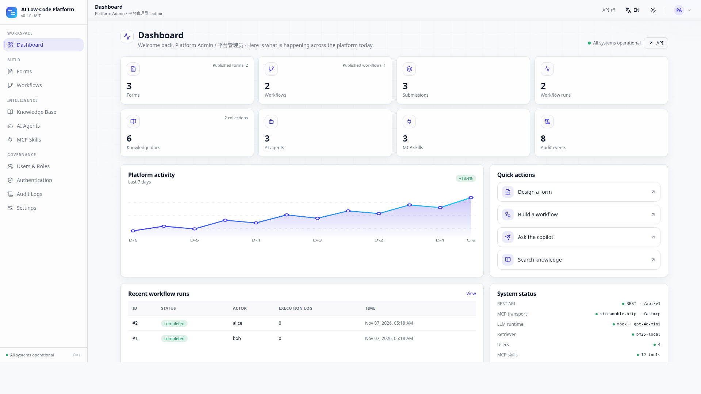 | 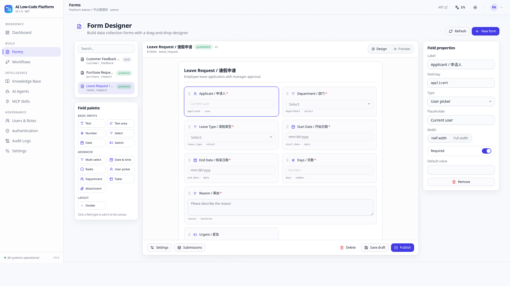 |

| Workflow Studio | AI Agents |
| --- | --- |
| 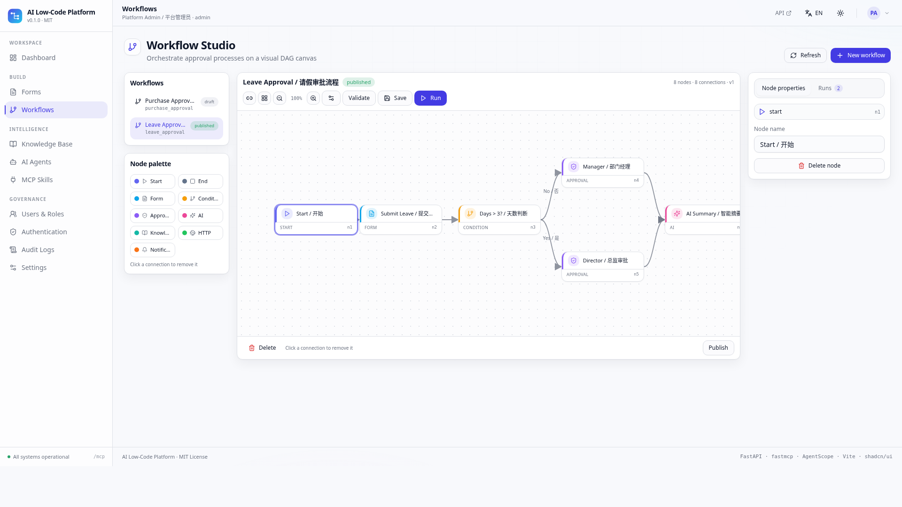 | 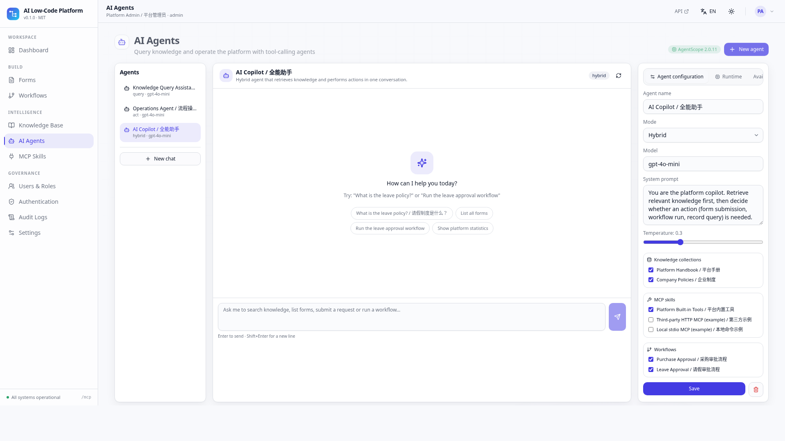 |

| Knowledge Base (RAG) | MCP Servers | Skills | Dark theme |
| --- | --- | --- | --- |
| 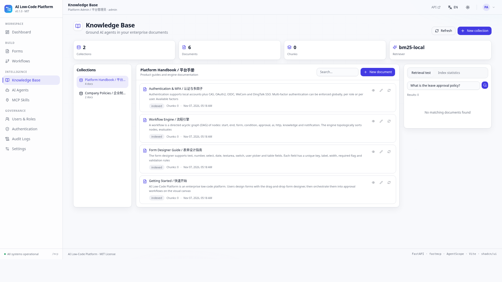 | 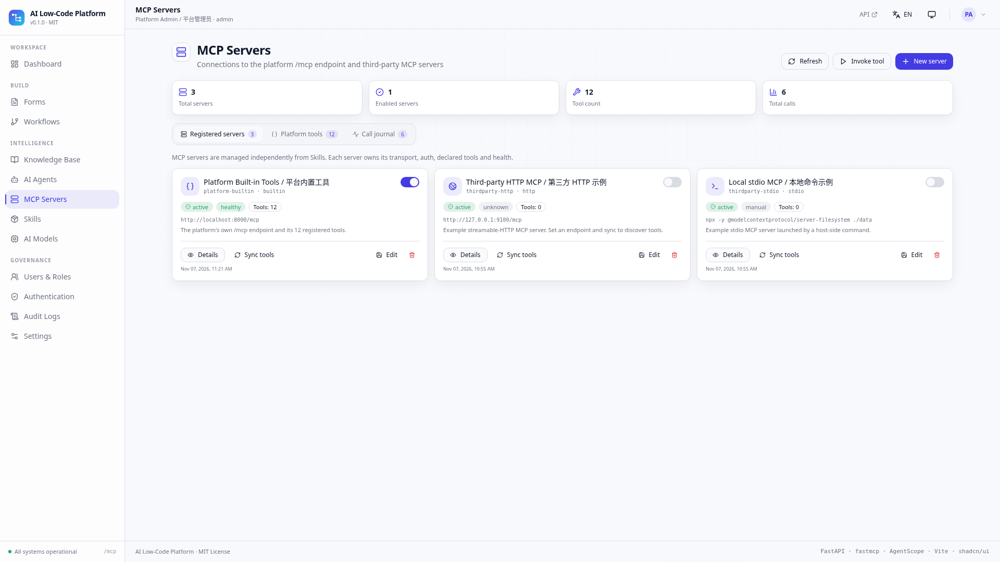 | 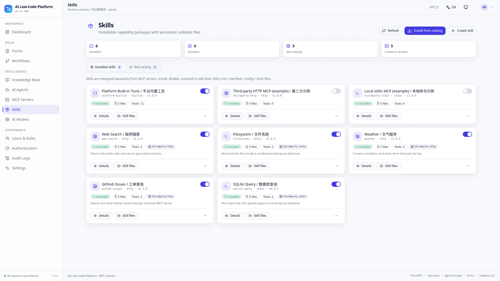 | 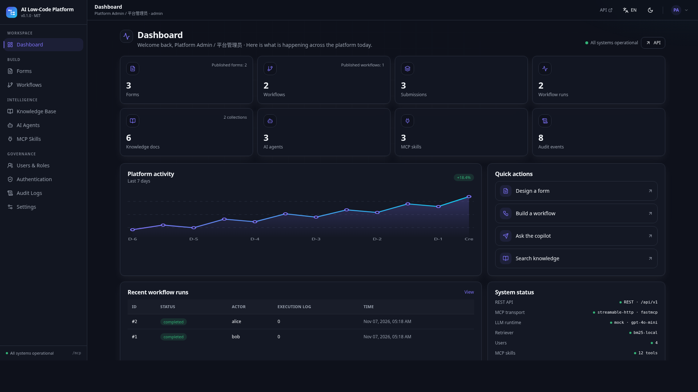 |

| AI Model Services | Knowledge Upload | Agent Bindings | Users & Roles |
| --- | --- | --- | --- |
| 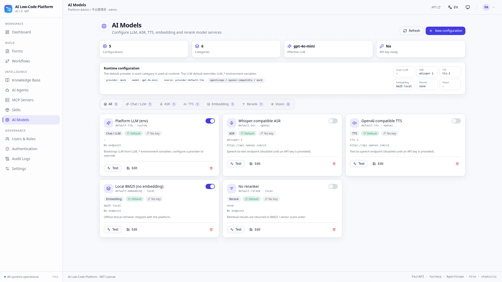 | 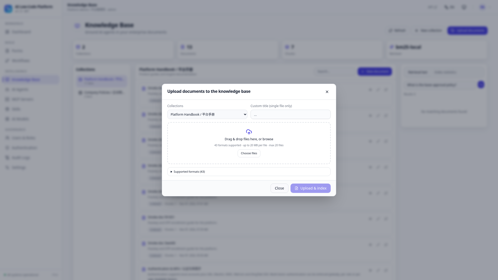 | 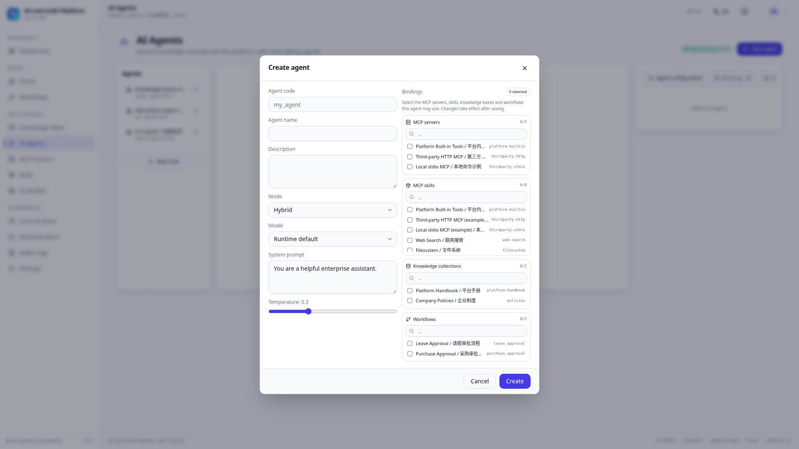 | 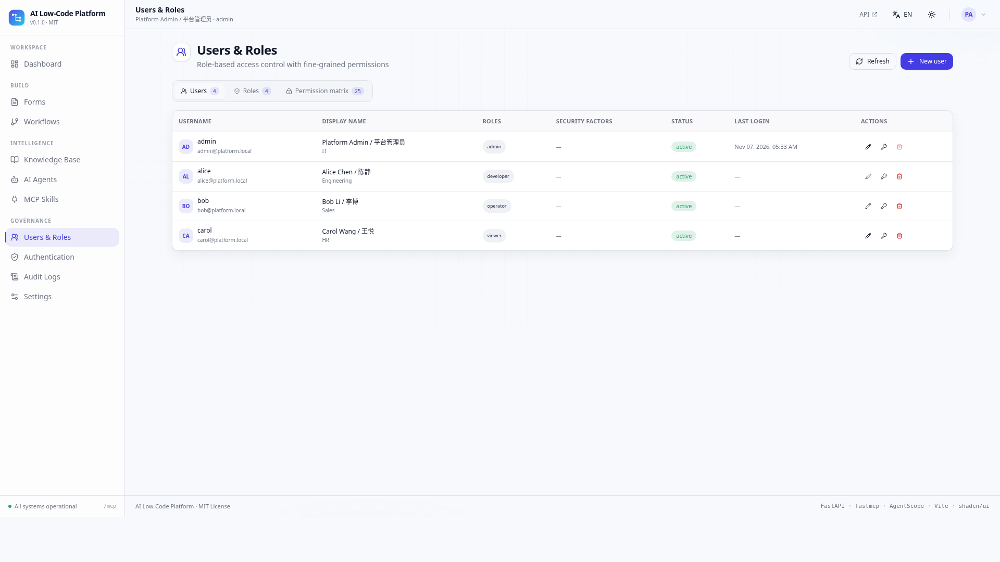 |

---

## Features

| Area | What is implemented |
| --- | --- |
| **Visual form designer (China-ready)** | **44 field types in 5 groups** (身份证 / 统一社会信用代码 / 手机号 / 银行卡 / 金额大写 / 省市区 / 手写签名 / 明细表 / 组织架构 …), click-to-add grouped palette, drag-to-reorder, Basic/Rules/Advanced property tabs, `visible_when` / `required_when` rule editor, restricted-AST formula sandbox (19 functions incl. `CNY_UPPER` / `TABLE_SUM`), detail-table row formulas & summaries, node-level field permissions, form versions & restore, serial numbers, print view, CSV export, desktop/mobile preview, draft/publish/archive, submissions |
| **Visual workflow orchestration & approval** | Drag-and-drop DAG canvas with bezier edges, **14 node types** (adds `cc` / `parallel` / `join` / `delay` / `subflow`), connect mode, condition groups, node config panel, zoom, auto-layout, cycle detection, synchronous dry-run engine **plus a long-running human approval runtime**: 9 approver rules (部门主管 / 逐级主管 …), 4 signing modes (或签 / 会签 / 比例 / 依次审批), parallel branches & join, CC, reject / return / transfer / add-sign / withdraw / urge, timeouts & delegation, task center, instance timeline, pinned graph snapshots & workflow versions |
| **REST API** | 120 OpenAPI paths (157 route decorators) under `/api/v1`, Pydantic request/response models, auto OpenAPI at `/docs`, consistent error codes, audit logging on every mutation |
| **MCP** | Real `fastmcp` streamable-HTTP server at `/mcp` (initialize / tools/list / tools/call / resources / prompts), 12 platform tools plus a `call_remote_tool` bridge, and a dependency-free built-in JSON-RPC fallback |
| **MCP servers** | Independent `/mcp/servers` registry: CRUD for `http`/`sse`/`stdio` connections, auth config, probe / sync tool discovery, health & status, enable/disable and per-server tool invocation |
| **Skills** | Independent `/skills` registry: installable catalog, install/enable/disable/uninstall/reinstall, editable skill files with disk mirror, optional `server_id` link to an MCP server, linked-server sync |
| **AI model services** | `/ai/providers` configures `llm` / `asr` / `tts` / `embedding` / `rerank` / `vision` providers; one default per category, write-only API keys (masked on read), connectivity test, and an `llm` default that overrides `LLM_*` environment variables at runtime. **Settings → AI model services** edits the six defaults inline, with initial values bootstrapped from `.env` (`LLM_*`, `ASR_*`, `TTS_*`, `EMBEDDING_*`, `RERANK_*`, `VISION_*`) |
| **AI agents** | `query` / `act` / `hybrid` agents, AgentScope-compatible ReAct tool loop, RAG grounding, conversation persistence, source citations, visible tool-call steps; `GET /agents/meta/bindings` lets creation bind knowledge bases, skills, MCP servers and workflows from one searchable dialog (stale ids cleaned on save, tool scope enforced at runtime); `mock` / `openai-compatible` / `agentscope` LLM backends (works offline by default) |
| **Knowledge base** | Collections, documents, automatic chunking, mixed zh/en BM25 retrieval (unigram+bigram), assembled RAG context, retrieval test console, and **multi-format upload** — Markdown/TXT/CSV/JSON/YAML/HTML/XML, PDF, Word/Excel/PowerPoint (OOXML), OpenDocument, EPUB, RTF, images (OCR) and more, parsed and indexed immediately |
| **Call journal** | Every MCP / REST / Agent / internal invocation recorded with arguments, result preview, status, error, duration and target; stats, charts, filters and CSV export |
| **RBAC** | Users, roles, 25 fine-grained permissions, role×permission matrix, per-endpoint `Depends(require("x:y"))` enforcement, built-in admin/developer/operator/viewer roles |
| **SSO** | CAS, OAuth2, OIDC (discovery + ID token), WeCom (企业微信), DingTalk (钉钉) — configurable from the UI, with a clearly flagged demo mode so the whole redirect → callback → user-provisioning flow works without credentials |
| **MFA** | TOTP/OTP (RFC 6238, real 6-digit verification + otpauth QR), WebAuthn/Passkey registration & authentication, policy enforcement **globally / per role / per user**, enrollment flow at login |
| **UI/UX** | shadcn/ui-style component library, consistent layout, animated light/dark backgrounds, mobile-first responsive shell, i18n en/zh (default en), theme system/light/dark following the OS, no emoji (SVG icons only) |

---

## Architecture

```
ai-lowcode-platform/
├── backend/                    FastAPI application (uv, python-dotenv)
│   ├── app/
│   │   ├── main.py             app factory, SPA hosting, MCP ASGI mount, lifespan
│   │   ├── config.py           env-driven settings
│   │   ├── db.py               SQLite data access (JSON columns, WAL)
│   │   ├── security.py         JWT HS256, PBKDF2, TOTP, WebAuthn challenges, MFA policy
│   │   ├── deps.py             auth / RBAC dependencies, audit helper
│   │   ├── seed.py             deterministic bootstrap data
│   │   ├── mcp_server.py       fastmcp tools + builtin JSON-RPC fallback
│   │   ├── routers/            auth, rbac, forms, workflows, knowledge, agents, mcp,
│   │   │                       mcp_servers, skills, ai_providers, audit, meta
│   │   └── services/           workflow_engine, flow_runtime, form_catalog, form_rules,
│   │                           rag, llm, mcp_tools, mcp_servers, model_providers,
│   │                           documents, mcp_journal, skill_catalog, skill_files, sso
│   └── tests/smoke.py          157 end-to-end API assertions
└── frontend/                   Vite + React + TS SPA
    └── src/
        ├── components/ui/      shadcn-style primitives, dialogs, toasts, table
        ├── components/layout/  AppShell (sidebar, header, theme/locale switches)
        ├── i18n/               en/zh dictionaries + provider
        ├── theme/              ThemeProvider (system/light/dark)
        ├── store/              AppContext (session, bootstrap catalogs, permissions)
        ├── lib/                api client, utils, WebAuthn helpers
        └── pages/              14 page modules incl. MCP servers, Skills & AI models
```

**One registry, three consumers.** `services/mcp_tools.py` declares every platform capability once (name, JSON Schema, permission). The MCP server, the AI agents' tool loop and the REST `/mcp/invoke` endpoint all call the same handlers — so an agent can genuinely submit a form or run a workflow, not just talk about it.

**Auth flow.** `POST /auth/login` → JWT, or an MFA challenge when a global/role/user policy applies. SSO callbacks provision local users automatically. Every API route is guarded by an RBAC dependency; MCP requests may carry the same bearer token through a pure-ASGI middleware.

---

## Quick start

Prerequisites: **Python 3.11+**, **Node 18+**, `uv`, `pnpm`.

```bash
git clone <your-repo> && cd ai-lowcode-platform
chmod +x scripts/*.sh
./scripts/setup.sh           # uv sync + pnpm install + .env templates
./scripts/dev.sh             # backend :8000 + Vite dev :5173
```

Or single-port (production build served by FastAPI):

```bash
./scripts/start.sh           # builds frontend/dist, serves everything at http://localhost:8000
```

Open **http://localhost:5173** (dev) or **http://localhost:8000** (single port).
API docs: `/docs` · OpenAPI: `/openapi.json` · Health: `/api/v1/meta/health` · MCP: `/mcp`.

### Demo accounts

| Username | Password | Role | Access |
| --- | --- | --- | --- |
| `admin` | `admin123` | admin | everything (`*`) |
| `alice` | `demo1234` | developer | build forms, workflows, agents, knowledge |
| `bob` | `demo1234` | operator | submit forms, run workflows, chat |
| `carol` | `demo1234` | viewer | read-only |

The database is created and seeded automatically on first boot. CAS ships enabled in **demo mode** — click it on the login page to exercise the complete SSO flow.

---

## Guided tour

1. **Forms** → open `leave_request` → edit a field in the property panel → switch to **Preview** → fill & submit → view submissions.
2. **Workflows** → open `leave_approval` → drag a node, use **Connect** to add an edge → **Validate** → **Run** with `{"days": 5}` → inspect the condition branch (`true` → director approval).
3. **Knowledge Base** → run a retrieval test, e.g. `请假制度 leave policy` → see BM25 hits and the assembled context.
4. **AI Agents** → open *AI Copilot* → ask `List all forms and show platform statistics` → watch real tool calls with results; ask `What is the leave policy?` for a grounded answer with citations.
5. **MCP servers & Skills** → on `/mcp`, register a server and **Sync** its tools → on `/skills`, install a skill from the **catalog**, edit `config.json`, disable / reinstall → open the **Call journal** to filter and export CSV.
6. **AI models** → `/models` — switch category tabs, mark an `llm` provider as default (it overrides `LLM_*` at runtime) and run a connectivity test.
7. **Knowledge upload** → drag a `.docx` / `.xlsx` / `.pdf` / `.md` file into the upload dialog, then inspect its parse status and the immediate BM25 index.
8. **Agent bindings** → create an agent and bind knowledge bases, skills, MCP servers and workflows from one searchable dialog; stale ids are cleaned automatically.
9. **Authentication & locale** → enable an SSO provider, enforce OTP for a role, enroll a factor in **Settings**, then toggle **EN/中文** and the theme (system/light/dark).
10. **Domestic form & approval** → open `expense_claim` to see the 44-field grouped palette, Rules tab, `TABLE_SUM` formula, RMB amount-in-words, detail table and **Versions / Print / CSV**; then open `expense_approval`, click **Start approval**, and use **Task center** to approve / reject / return / transfer / add signer through the countersign + parallel + join chain.

Deep links are supported: `/#/forms?form=leave_request`, `/#/forms?form=expense_claim`, `/#/workflows?workflow=leave_approval`, `/#/workflows?workflow=expense_approval`, `/#/agents?agent=general_copilot`.

---

## API & MCP highlights

| Endpoint | Purpose |
| --- | --- |
| `POST /api/v1/auth/login`, `/auth/mfa/verify`, `/auth/otp/*`, `/auth/passkey/*`, `/auth/sso/*` | Authentication, MFA, SSO |
| `/api/v1/forms`, `/workflows`, `/knowledge`, `/agents`, `/mcp`, `/mcp/servers`, `/skills`, `/ai/providers`, `/rbac`, `/audit`, `/settings`, `/meta` | Full resource CRUD + actions |
| `POST /api/v1/workflows/{id}/validate`, `/run` | DAG validation and execution |
| `GET /forms/meta`, `POST /forms/{id}/evaluate`, `/validate`, `/versions`, `/render`, `/print/{sid}`, `/submissions/export` | 44-field catalog, live formula/permission evaluation, versions, print & CSV |
| `POST /workflows/{id}/start`, `GET /workflows/tasks`, `/instances/{id}/tasks/{tid}/act`, `/timeline`, `/form-schema`, `/delegations` | Long-running approval: start, task center, human actions, node field permissions, delegation |
| `POST /api/v1/knowledge/search`, `/knowledge/upload`, `GET /knowledge/formats` | RAG retrieval, multi-format upload, format catalog |
| `POST /api/v1/agents/{id}/chat`, `GET /agents/meta/bindings` | ReAct agent chat and bindable resources |
| `GET /api/v1/meta/bootstrap` | All UI catalogs (field types, node types, permissions, providers, runtime) in one call |
| `POST /mcp` | MCP streamable HTTP (`initialize`, `tools/list`, `tools/call`, `resources/*`, `prompts/*`) |

MCP tools: `list_forms`, `get_form`, `submit_form`, `query_records`, `list_workflows`, `get_workflow`, `run_workflow`, `get_workflow_instance`, `list_collections`, `search_knowledge`, `list_users`, `get_stats`. The `call_remote_tool` bridge forwards calls to tools declared by enabled MCP servers.

Any MCP client can connect to `http://localhost:8000/mcp`. Optionally send `Authorization: Bearer <token>` so tool calls are RBAC-checked.

---

## Configuration

Copy `backend/.env.example` to `backend/.env`. Key settings:

| Variable | Default | Notes |
| --- | --- | --- |
| `SECRET_KEY` | dev-only | **Change in production** (JWT HS256 signing) |
| `DB_PATH` | `./data/platform.db` | SQLite file |
| `LLM_PROVIDER` | `mock` | `mock` (offline) / `openai-compatible` / `agentscope` |
| `LLM_API_KEY`, `LLM_BASE_URL`, `LLM_MODEL` | — | needed only for real LLM calls; an `llm` provider marked default in `/ai/providers` overrides these at runtime |
| `ASR_*`, `TTS_*`, `EMBEDDING_*`, `RERANK_*` | — | bootstrap defaults for non-LLM model categories; runtime configuration lives in `/ai/providers` |
| `MFA_REQUIRED`, `MFA_ENFORCED_ROLES`, `MFA_ENFORCED_USERS` | off | MFA policy (also editable in the UI) |
| `PASSKEY_RP_ID`, `PASSKEY_ORIGIN` | localhost | WebAuthn relying party |
| `CAS_*`, `OAUTH2_*`, `OIDC_*`, `WECOM_*`, `DINGTALK_*` | — | SSO credentials (also editable in the UI) |
| `MCP_EXTERNAL_SERVERS` | — | legacy hint; third-party MCP connections are registered via `/mcp/servers` |
| `CORS_ORIGINS` | localhost:5173 | frontend origin, also used for SSO redirects |

Frontend: `frontend/.env.example` (`VITE_API_BASE=/api/v1`, proxied to `:8000` by Vite).

---

## i18n & theme

- **English is the default**; switch to 中文 in the header (persisted in `localStorage`). All UI strings live in `frontend/src/i18n/locales.ts` (740 leaf keys per locale, verified complete).
- **Theme defaults to `system`** and follows `prefers-color-scheme`; light/dark can be forced. Design tokens are CSS HSL variables in `frontend/src/index.css`, following the shadcn/ui convention.
- Platform defaults (`default_locale`, `default_theme`, …) are also stored server-side via `/api/v1/settings`.

---

## Documentation

Full design and architecture documentation lives in [`docs/`](docs/README.md):

| Document | Covers |
| --- | --- |
| [System Architecture](docs/architecture.md) ([中文](docs/architecture.zh-CN.md)) | C4 context/container/component views, request pipeline, runtime sequences, deployment, quality attributes, traceability |
| [AI System Design](docs/ai-design.md) ([中文](docs/ai-design.zh-CN.md)) | LLM runtime & degradation, ReAct orchestration, unified tool registry, RAG/BM25, MCP exposure, prompt spec, safety boundary, production upgrade path |
| [Security Architecture](docs/security.md) | JWT/PBKDF2/TOTP/WebAuthn, 25 RBAC permissions, SSO, MFA policy, audit, threat model |
| [Data Model](docs/data-model.md) | 26 tables, 17 indexes, JSON columns, ER diagram, seed data, lazy migrations |
| [REST & MCP API Reference](docs/api-reference.md) | All 120 OpenAPI paths, MCP methods, 12 tool schemas, examples |
| [MCP Servers, Skills & Call Journal](docs/mcp-skills.md) | Independent registries, skill lifecycle, editable files, invocation journal, sources and RBAC |
| [Knowledge Upload](docs/knowledge-upload.md) | Supported formats, parsing pipeline, upload API and validation |
| [AI Model Services](docs/ai-models.md) | Six model categories, provider CRUD, write-only keys, defaults and runtime resolution |
| [Domestic Form & Approval Spec](docs/form-flow-domestic.md) | 44 China-localized fields, statutory validation, formula sandbox, 14-node approval runtime, countersign / parallel / delegation, versions, print & CSV |
| [ADR index](docs/adr/README.md) | 9 accepted architecture decision records + template |

Real UI screenshots: [`docs/screenshots/`](docs/screenshots/).

---

## Testing

```bash
cd backend
uv run --extra dev ruff check app       # lint (dev extra)
python tests/smoke.py                   # or: uv run python tests/smoke.py

cd ../frontend
pnpm typecheck && pnpm build
pnpm check:i18n                         # en/zh key parity
```

The smoke suite covers 157 assertions: auth/RBAC (including a 403 denial), form publish/validation/submit, DAG validation and both condition branches, RAG indexing, agent tool loops, MCP handshake/tools/call, SSO demo provisioning, MFA enrollment, audit logs, SPA hosting and API 404 handling, plus the MCP call journal (recording, statistics, CSV export, clearing) and the full skill lifecycle (install, file CRUD, path traversal rejection, enable/disable/uninstall/reinstall), plus the split MCP server / Skill registries, AI model providers, multi-format knowledge upload and agent resource bindings. The final 41 assertions cover the domestic form/approval runtime: 44-field catalog, statutory validators, detail-table formulas, RMB amount-in-words, conditional display, mobile render, versions, CSV/print, 14 node types, 9 approver rules, 4 signing modes, and the full `expense_approval` chain (leader → parallel countersign → join → CC → approved) plus transfer, add-sign, return, urge, withdraw, timeout sweep and delegation.

---

## Production notes

This repository is a **complete, runnable reference implementation**. Before production use, harden the following:

- **Passkeys** use demo-grade registration (challenge binding + credential storage). Install the `webauthn` extra to enable full attestation/assertion verification; WebAuthn requires HTTPS.
- **SSO providers without credentials run in demo mode** and provision a synthetic user — configure real credentials and disable demo mode.
- **LLM defaults to `mock`** so every feature works offline; set `LLM_PROVIDER=openai-compatible` (or `agentscope`) plus an API key for real models.
- **The synchronous `/run` engine is still a dry-run simulator** (auto-approve, no outbound request) — real human approvals use `POST /workflows/{id}/start` and the task center. Remaining demo-grade parts: `subflow` / `delay` nodes, `signature` / `attachment` file storage, the compact GB/T 2260 region sample, and the SQLite single-node store (see [FFC-001 §7](docs/form-flow-domestic.md)).
- Replace SQLite with PostgreSQL for multi-instance deployments, set a strong `SECRET_KEY`, enable HTTPS, and enforce MCP authentication for untrusted clients.

---

## License

[MIT](LICENSE) © 2026 AI Low-Code Platform Team
