# AI 低代码平台

> 一套 AI 原生的全栈低代码平台：**面向国内场景的可视化表单设计**（44 种字段、法定校验、公式沙箱、明细表、条件规则）、可视化 **DAG 流程编排**与**长时人工审批运行时**（会签、并行/汇聚、委托、任务动作）、完整的 **RESTful 接口**、**MCP**（streamable HTTP，**MCP 服务与技能各自独立管理**）、**多类别 AI 模型服务**（LLM/ASR/TTS/Embedding/Rerank/Vision）、**多格式知识库上传**（Office/PDF/Markdown 等）、带声明式资源绑定的基于知识库的 **AI 查询/操作智能体**、完整的 **RBAC**、**CAS / OAuth2 / OIDC / 企业微信 / 钉钉 SSO**，以及可按角色/用户配置的 **Passkey + OTP 多因子认证**。详见[国内表单与审批规范](docs/form-flow-domestic.md)。

前端：**Vite + React + TypeScript + shadcn/ui 设计体系** · 后端：**uv + python-dotenv + FastAPI + fastmcp + AgentScope** · **MIT 协议** · **i18n 中英文（默认英文）** · **主题 system / light / dark**。

English: [README.md](README.md) · 后端：[backend/README.zh-CN.md](backend/README.zh-CN.md) · 前端：[frontend/README.zh-CN.md](frontend/README.zh-CN.md)

---

## 界面截图

| 总览 | 表单设计器 |
| --- | --- |
| 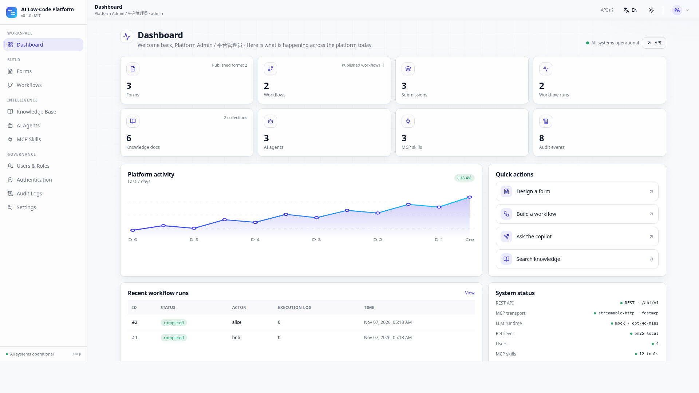 | 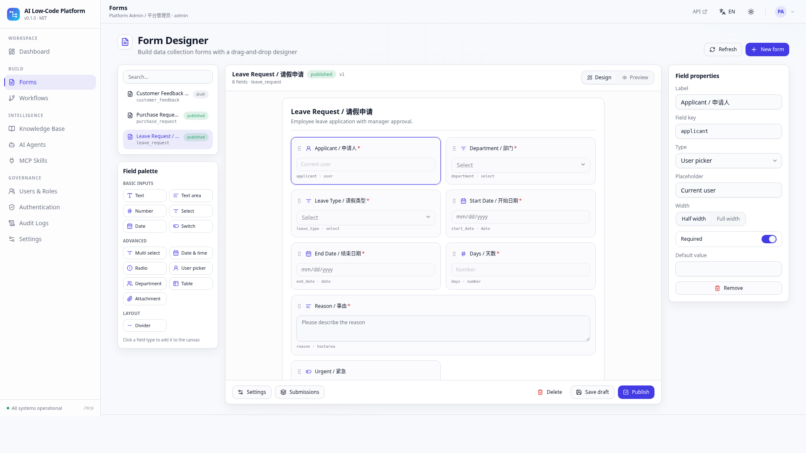 |

| 流程编排 | AI 智能体 |
| --- | --- |
| 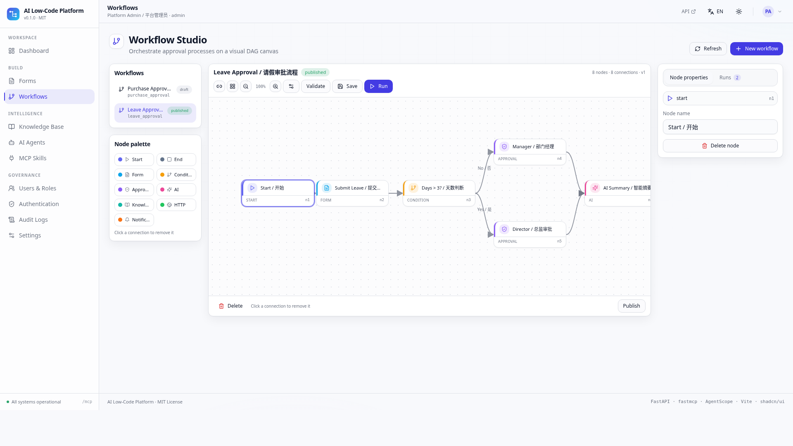 | 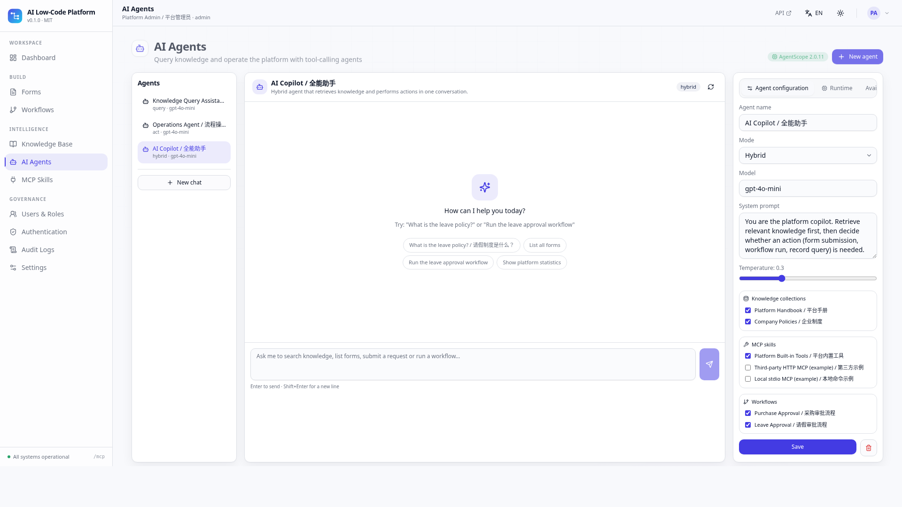 |

| 知识库检索 | MCP 服务 | 技能 | 深色主题 |
| --- | --- | --- | --- |
| 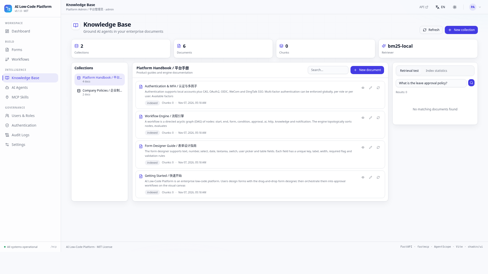 | 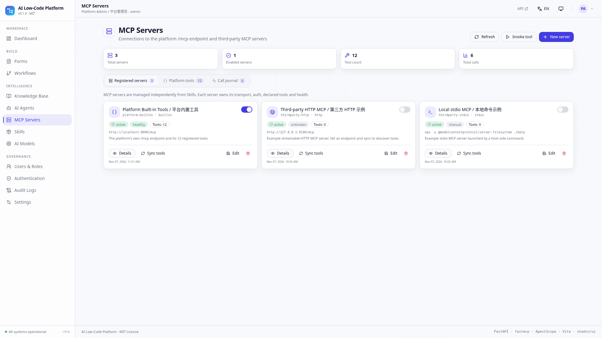 | 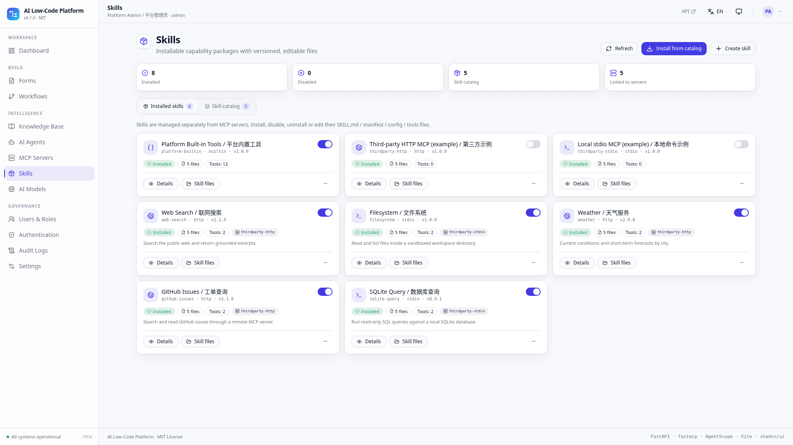 | 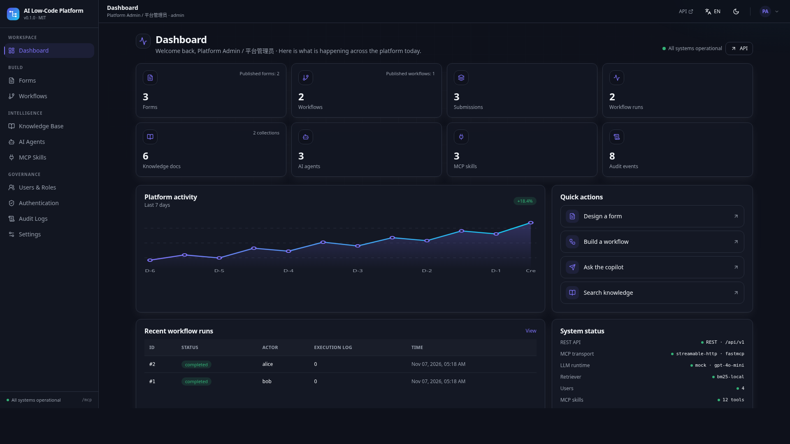 |

| AI 模型服务 | 知识库上传 | 智能体绑定 | 用户与角色 |
| --- | --- | --- | --- |
| 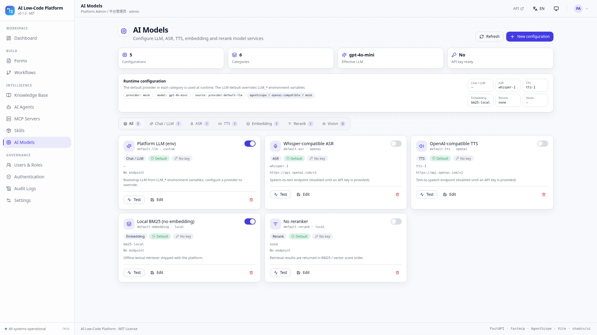 | 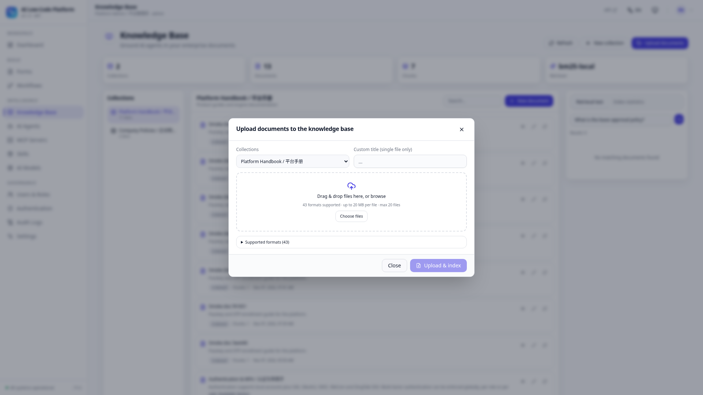 | 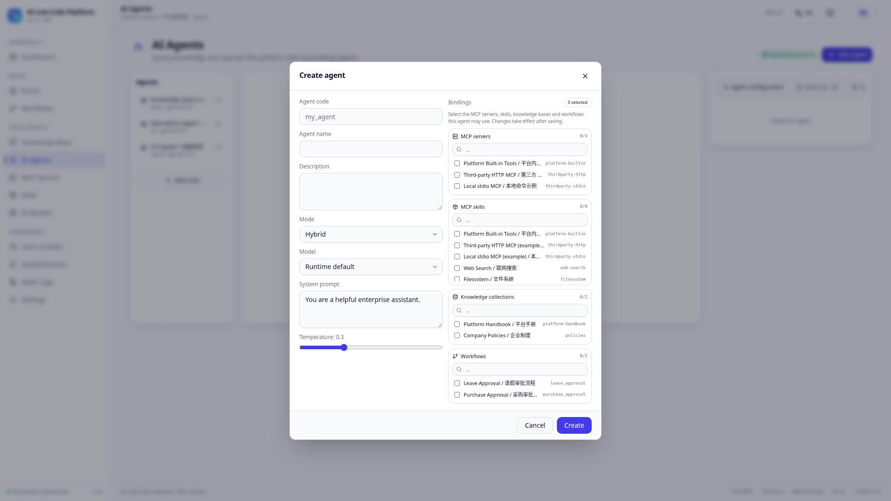 | 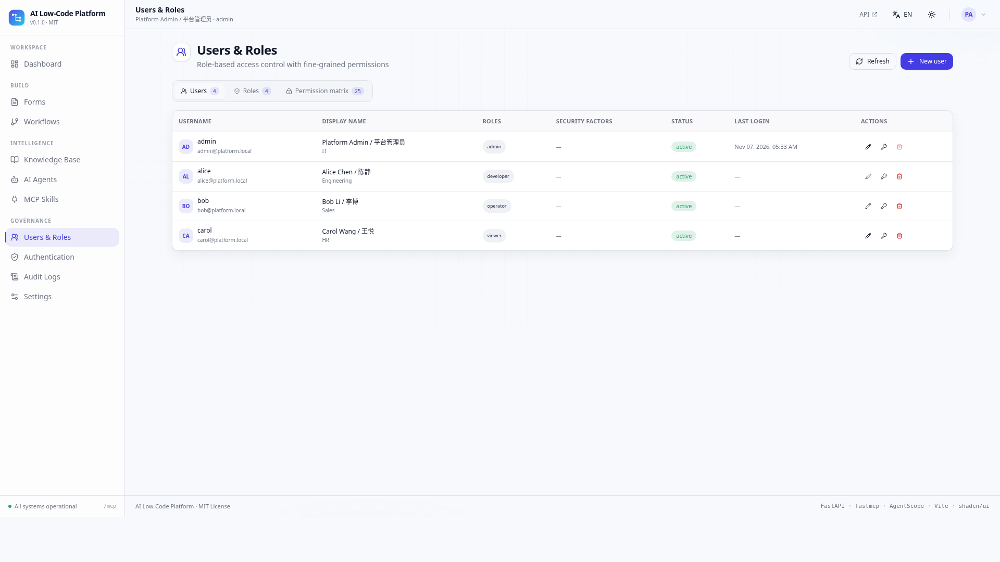 |

---

## 功能清单

| 模块 | 已实现能力 |
| --- | --- |
| **可视化表单设计（国内增强）** | **5 组 44 种字段**（身份证 / 统一社会信用代码 / 手机号 / 银行卡 / 金额大写 / 省市区 / 手写签名 / 明细表 / 组织架构 …），分组折叠字段面板、拖拽排序、Basic/Rules/Advanced 属性页签、`visible_when` / `required_when` 条件规则编辑器、受限 AST 公式沙箱（19 个函数，含 `CNY_UPPER` / `TABLE_SUM`）、明细表行公式与列汇总、节点字段权限、表单版本与恢复、流水号、打印视图、CSV 导出、桌面/移动预览、草稿/发布/归档、提交记录 |
| **可视化流程编排与审批** | 可拖拽 DAG 画布 + 贝塞尔连线，**14 种节点**（新增 `cc` / `parallel` / `join` / `delay` / `subflow`）、连线模式、条件组、节点配置面板、缩放、自动布局、图校验（环检测）、同步 dry-run 执行引擎，**并新增长时人工审批运行时**：9 类审批人规则（部门主管 / 逐级主管 …）、4 种会签方式（或签 / 会签 / 比例 / 依次审批）、并行分支与汇聚、抄送、驳回 / 退回 / 转交 / 加签 / 撤回 / 催办、超时与委托、任务中心、实例时间线、graph 快照与流程版本固定 |
| **RESTful 接口** | `/api/v1` 下 120 个 OpenAPI 路径（157 个路由装饰器），Pydantic 请求/响应模型，自动生成 `/docs`，统一错误码，所有写操作记录审计日志 |
| **MCP** | 基于 `fastmcp` 的真实 streamable HTTP 服务 `/mcp`（initialize / tools/list / tools/call / resources / prompts），12 个平台工具外加 `call_remote_tool` 桥接工具，并内置零依赖 JSON-RPC 降级实现 |
| **MCP 服务** | 独立的 `/mcp/servers` 注册表：`http`/`sse`/`stdio` 连接 CRUD、认证配置、探测/同步工具发现、健康与状态、启用/禁用、按服务调用工具 |
| **技能** | 独立的 `/skills` 注册表：可安装目录、安装/启用/禁用/卸载/重装、可编辑技能文件与磁盘镜像、可选 `server_id` 关联 MCP 服务、关联服务同步 |
| **AI 模型服务** | `/ai/providers` 配置 `llm` / `asr` / `tts` / `embedding` / `rerank` / `vision` 六类模型；每类一个默认项、API Key 只写（读取时脱敏）、连通性测试，`llm` 默认项在运行时覆盖 `LLM_*` 环境变量。**设置 → AI 模型服务** 可直接改六类默认项，初始值由 `.env`（`LLM_*`、`ASR_*`、`TTS_*`、`EMBEDDING_*`、`RERANK_*`、`VISION_*`）引导 |
| **AI 智能体** | `query` / `act` / `hybrid` 三类智能体，兼容 AgentScope 的 ReAct 工具循环，RAG grounding、会话持久化、来源引用、工具调用步骤可见；`GET /agents/meta/bindings` 让创建时可在同一搜索式对话框中绑定知识库、技能、MCP 服务与工作流（保存时清理失效 id、运行时收窄工具域）；`mock` / `openai-compatible` / `agentscope` 三种后端（默认离线可用） |
| **知识库** | 集合、文档、自动分块、中英混合 BM25 检索（单字 + 双字 gram）、上下文组装、检索测试台，以及**多格式上传**——Markdown/TXT/CSV/JSON/YAML/HTML/XML、PDF、Word/Excel/PowerPoint（OOXML）、OpenDocument、EPUB、RTF、图片（OCR）等，上传即解析并立即索引 |
| **调用日记** | 记录 MCP / REST / Agent / internal 每次调用的参数、结果预览、状态、错误、耗时与目标；提供统计、图表、筛选与 CSV 导出 |
| **RBAC** | 用户、角色、25 项细粒度权限、角色×权限矩阵、接口级 `Depends(require("x:y"))` 校验、内置 admin/developer/operator/viewer 角色 |
| **SSO** | CAS、OAuth2、OIDC（discovery + ID Token）、企业微信、钉钉，均可在界面配置；未配置凭据时进入明确标注的演示模式，完整走通跳转 → 回调 → 自动建号 |
| **MFA** | TOTP/OTP（RFC 6238 真实 6 位校验 + otpauth 二维码）、WebAuthn/Passkey 注册与认证，**全局 / 按角色 / 按用户**强制策略、登录时引导注册 |
| **UI/UX** | shadcn/ui 风格组件库、统一布局、浅色动态背景与深色模式、移动优先响应式、中英文切换（默认英文）、system/light/dark 跟随系统主题、禁用 emoji（仅 SVG 图标） |

---

## 架构

```
ai-lowcode-platform/
├── backend/                    FastAPI 应用（uv + python-dotenv）
│   ├── app/
│   │   ├── main.py             应用入口、SPA 托管、MCP ASGI 挂载、生命周期
│   │   ├── config.py          环境变量配置
│   │   ├── db.py              SQLite 数据访问（JSON 列、WAL）
│   │   ├── security.py        JWT HS256、PBKDF2、TOTP、WebAuthn challenge、MFA 策略
│   │   ├── deps.py            认证 / RBAC 依赖、审计工具
│   │   ├── seed.py            确定性演示数据
│   │   ├── mcp_server.py      fastmcp 工具 + 内置 JSON-RPC 降级
│   │   ├── routers/           auth, rbac, forms, workflows, knowledge, agents, mcp,
│   │   │                      mcp_servers, skills, ai_providers, audit, meta
│   │   └── services/          workflow_engine, flow_runtime, form_catalog, form_rules,
│   │                          rag, llm, mcp_tools, mcp_servers, model_providers,
│   │                          documents, mcp_journal, skill_catalog, skill_files, sso
│   └── tests/smoke.py         157 项端到端 API 断言
└── frontend/                   Vite + React + TS 单页应用
    └── src/
        ├── components/ui/     shadcn 风格基础组件、对话框、Toast、表格
        ├── components/layout/ AppShell（侧栏、顶栏、主题/语言切换）
        ├── i18n/              en/zh 字典 + Provider
        ├── theme/             ThemeProvider（system/light/dark）
        ├── store/             AppContext（会话、元数据字典、权限）
        ├── lib/               api client、工具函数、WebAuthn 辅助
        └── pages/             14 个页面模块（含 MCP 服务、技能与 AI 模型页）
```

**一份注册表，三处复用。** `services/mcp_tools.py` 统一声明每个平台能力的名称、JSON Schema 与所需权限。MCP 服务、AI 智能体的工具循环、REST `/mcp/invoke` 调用同一组处理函数——因此智能体是**真的**能提交表单、运行流程，而不是模拟对话。

**认证链路。** `POST /auth/login` → 返回 JWT，或在命中全局/角色/用户 MFA 策略时返回二次验证挑战。SSO 回调自动创建本地用户。每个接口都由 RBAC 依赖守卫；MCP 请求可通过纯 ASGI 中间件携带同一 Bearer Token。

---

## 快速开始

环境要求：**Python 3.11+**、**Node 18+**、`uv`、`pnpm`。

```bash
git clone <your-repo> && cd ai-lowcode-platform
chmod +x scripts/*.sh
./scripts/setup.sh           # uv sync + pnpm install + 生成 .env
./scripts/dev.sh             # 后端 :8000 + Vite 开发服务 :5173
```

或使用单端口（由 FastAPI 托管前端构建产物）：

```bash
./scripts/start.sh           # 构建 frontend/dist，全部由 http://localhost:8000 提供
```

访问 **http://localhost:5173**（开发）或 **http://localhost:8000**（单端口）。
接口文档：`/docs` · OpenAPI：`/openapi.json` · 健康检查：`/api/v1/meta/health` · MCP：`/mcp`。

### 演示账号

| 用户名 | 密码 | 角色 | 权限 |
| --- | --- | --- | --- |
| `admin` | `admin123` | admin | 全部（`*`） |
| `alice` | `demo1234` | developer | 构建表单、流程、智能体、知识库 |
| `bob` | `demo1234` | operator | 提交表单、运行流程、对话 |
| `carol` | `demo1234` | viewer | 只读 |

数据库在首次启动时自动创建并填充演示数据。CAS 默认以**演示模式**启用——在登录页点击即可走通完整 SSO 流程。

---

## 功能体验

1. **表单设计** → 打开 `leave_request` → 在右侧属性面板修改字段 → 切到 **Preview** → 填写并提交 → 查看提交记录。
2. **流程编排** → 打开 `leave_approval` → 拖动节点、用 **Connect** 连线 → **Validate** → **Run** 输入 `{"days": 5}` → 观察条件分支（true → 总监审批）。
3. **知识库** → 检索测试输入 `请假制度 leave policy` → 查看 BM25 命中与组装上下文。
4. **AI 智能体** → 打开 *AI Copilot* → 询问 `List all forms and show platform statistics` → 查看真实工具调用与结果；再问 `What is the leave policy?` 得到带引用的答案。
5. **MCP 服务与技能** → 在 `/mcp` 注册服务并**同步**工具 → 在 `/skills` 从**技能目录**安装技能、编辑 `config.json`、禁用 / 重装 → 打开**调用日记**筛选并导出 CSV。
6. **AI 模型** → `/models` 切换类别页签、把某个 `llm` 配置设为默认（运行时覆盖 `LLM_*`）并执行连通性测试。
7. **知识库上传** → 把 `.docx` / `.xlsx` / `.pdf` / `.md` 文件拖入上传对话框，查看解析状态与即时 BM25 索引。
8. **智能体绑定** → 创建智能体，在同一搜索式对话框中绑定知识库、技能、MCP 服务与工作流；失效 id 自动清理。
9. **认证与语言** → 启用 SSO 提供方、对某角色强制 OTP、在 **设置** 页绑定因子，再切换 **EN/中文** 与主题（system/light/dark）。
10. **国内表单与审批** → 打开 `expense_claim` 查看 44 字段分组面板、Rules 页签、`TABLE_SUM` 公式、人民币大写、明细表，以及**版本 / 打印 / CSV 导出**；再打开 `expense_approval`，点击 **Start approval**，在**任务中心**沿「部门主管 → 并行会签 → 汇聚 → 抄送」链路执行同意 / 驳回 / 退回 / 转交 / 加签。

支持深链接：`/#/forms?form=leave_request`、`/#/forms?form=expense_claim`、`/#/workflows?workflow=leave_approval`、`/#/workflows?workflow=expense_approval`、`/#/agents?agent=general_copilot`。

---

## 接口与 MCP 速览

| 接口 | 用途 |
| --- | --- |
| `POST /api/v1/auth/login`、`/auth/mfa/verify`、`/auth/otp/*`、`/auth/passkey/*`、`/auth/sso/*` | 认证、MFA、SSO |
| `/api/v1/forms`、`/workflows`、`/knowledge`、`/agents`、`/mcp`、`/mcp/servers`、`/skills`、`/ai/providers`、`/rbac`、`/audit`、`/settings`、`/meta` | 资源 CRUD + 动作接口 |
| `POST /api/v1/workflows/{id}/validate`、`/run` | DAG 校验与执行 |
| `GET /forms/meta`、`POST /forms/{id}/evaluate`、`/validate`、`/versions`、`/render`、`/print/{sid}`、`/submissions/export` | 44 字段目录、公式/权限实时求值、版本、打印与 CSV |
| `POST /workflows/{id}/start`、`GET /workflows/tasks`、`/instances/{id}/tasks/{tid}/act`、`/timeline`、`/form-schema`、`/delegations` | 长时审批：发起、任务中心、人工动作、节点字段权限、委托 |
| `POST /api/v1/knowledge/search`、`/knowledge/upload`，`GET /knowledge/formats` | RAG 检索、多格式上传、格式清单 |
| `POST /api/v1/agents/{id}/chat`，`GET /agents/meta/bindings` | ReAct 智能体对话与可绑定资源 |
| `GET /api/v1/meta/bootstrap` | 一次返回全部 UI 字典（字段类型、节点类型、权限、提供方、运行时） |
| `POST /mcp` | MCP streamable HTTP（initialize / tools/list / tools/call / resources / prompts） |

MCP 工具：`list_forms`、`get_form`、`submit_form`、`query_records`、`list_workflows`、`get_workflow`、`run_workflow`、`get_workflow_instance`、`list_collections`、`search_knowledge`、`list_users`、`get_stats`。`call_remote_tool` 桥接工具把调用转发给已启用 MCP 服务声明的工具。

任意 MCP 客户端可连接 `http://localhost:8000/mcp`；可选携带 `Authorization: Bearer <token>` 使工具调用受 RBAC 约束。

---

## 配置

复制 `backend/.env.example` 为 `backend/.env`。主要变量：

| 变量 | 默认值 | 说明 |
| --- | --- | --- |
| `SECRET_KEY` | 开发用 | **生产必须修改**（JWT HS256 签名） |
| `DB_PATH` | `./data/platform.db` | SQLite 文件 |
| `LLM_PROVIDER` | `mock` | `mock`（离线）/ `openai-compatible` / `agentscope` |
| `LLM_API_KEY`、`LLM_BASE_URL`、`LLM_MODEL` | — | 仅真实模型调用需要；`/ai/providers` 中设为默认的 `llm` 配置会在运行时覆盖这些变量 |
| `ASR_*`、`TTS_*`、`EMBEDDING_*`、`RERANK_*` | — | 非 LLM 模型类别的启动默认值；运行时配置以 `/ai/providers` 为准 |
| `MFA_REQUIRED`、`MFA_ENFORCED_ROLES`、`MFA_ENFORCED_USERS` | 关闭 | MFA 策略（也可在界面修改） |
| `PASSKEY_RP_ID`、`PASSKEY_ORIGIN` | localhost | WebAuthn relying party |
| `CAS_*`、`OAUTH2_*`、`OIDC_*`、`WECOM_*`、`DINGTALK_*` | — | SSO 凭据（也可在界面配置） |
| `MCP_EXTERNAL_SERVERS` | — | 遗留提示；第三方 MCP 连接现通过 `/mcp/servers` 注册 |
| `CORS_ORIGINS` | localhost:5173 | 前端来源，同时用于 SSO 回调跳转 |

前端配置见 `frontend/.env.example`（`VITE_API_BASE=/api/v1`，由 Vite 代理到 `:8000`）。

---

## 国际化与主题

- **默认英文**，顶栏可切换中文（持久化到 `localStorage`）。全部文案位于 `frontend/src/i18n/locales.ts`（每种语言 740 个叶子键，已校验无缺失）。
- **主题默认 `system`**，跟随 `prefers-color-scheme`，也可强制 light/dark。设计变量为 `frontend/src/index.css` 中的 HSL CSS 变量，遵循 shadcn/ui 约定。
- 平台默认值（`default_locale`、`default_theme` 等）同时通过 `/api/v1/settings` 存于服务端。

---

## 设计文档

完整的设计与架构文档位于 [`docs/`](docs/README.md)：

| 文档 | 内容 |
| --- | --- |
| [系统架构设计](docs/architecture.zh-CN.md)（[English](docs/architecture.md)） | C4 上下文/容器/组件视图、请求管线、运行时流程、部署、质量属性、需求可追溯 |
| [AI 系统设计](docs/ai-design.zh-CN.md)（[English](docs/ai-design.md)） | LLM 运行时与降级、ReAct 编排、统一工具注册表、RAG/BM25、MCP 暴露、Prompt 规范、安全边界、生产升级路径 |
| [安全架构](docs/security.md) | JWT/PBKDF2/TOTP/WebAuthn、25 项 RBAC 权限、SSO、MFA 策略、审计、威胁模型 |
| [数据模型](docs/data-model.md) | 26 张表、17 个索引、JSON 列、ER 图、种子数据、惰性迁移 |
| [REST 与 MCP 接口规范](docs/api-reference.md) | 全部 120 个 OpenAPI 路径、MCP 方法、12 个工具 Schema、调用示例 |
| [MCP 服务、技能与调用日记](docs/mcp-skills.md) | 独立注册表、技能生命周期、可编辑文件、调用日记、来源与权限 |
| [知识库上传](docs/knowledge-upload.md) | 支持格式、解析流程、上传接口与校验 |
| [AI 模型服务](docs/ai-models.md) | 六类模型、配置 CRUD、密钥只写、默认项与运行时解析 |
| [国内表单与审批规范](docs/form-flow-domestic.md) | 44 种本地化字段、法定校验、公式沙箱、14 节点审批运行时、会签/并行/委托、版本、打印与 CSV |
| [ADR 索引](docs/adr/README.md) | 9 份已接受的架构决策记录与模板 |

真实界面截图：[`docs/screenshots/`](docs/screenshots/)。

---

## 测试

```bash
cd backend
uv run --extra dev ruff check app       # 代码规范（dev extra）
python tests/smoke.py                   # 或：uv run python tests/smoke.py

cd ../frontend
pnpm typecheck && pnpm build
pnpm check:i18n                         # 中英文案键一致性
```

冒烟测试包含 157 项断言：认证/RBAC（含 403 拒绝）、表单发布/校验/提交、DAG 校验与两条条件分支、RAG 索引、智能体工具循环、MCP 握手/工具列举/调用、SSO 演示建号、MFA 注册、审计日志、SPA 托管与 API 404 处理，以及 MCP 调用日记（记录、统计、CSV 导出、清空）与技能完整生命周期（安装、文件增删查改、路径穿越拒绝、启用/禁用/卸载/重装），外加拆分后的 MCP 服务/技能注册表、AI 模型服务、多格式知识库上传与智能体资源绑定。最后 41 项覆盖国内表单/审批运行时：44 字段目录、法定校验、明细表公式、人民币大写、条件显隐、移动渲染、版本、CSV/打印、14 节点、9 类审批人规则、4 种会签方式，以及 `expense_approval` 完整链路（部门主管 → 并行会签 → 汇聚 → 抄送 → 通过），并覆盖转交、加签、退回、催办、撤回、超时扫描与委托。

---

## 生产化提示

本仓库是一套**完整可运行的参考实现**。上线前建议加固：

- **Passkey** 使用演示级注册（challenge 绑定 + 凭据存储）。安装 `webauthn` extra 以启用完整 attestation/assertion 校验；WebAuthn 需要 HTTPS。
- **未配置凭据的 SSO 提供方走演示模式**并创建合成用户——请配置真实凭据并关闭演示模式。
- **LLM 默认 `mock`**，保证离线可用；设置 `LLM_PROVIDER=openai-compatible`（或 `agentscope`）及 API Key 后接入真实模型。
- **同步 `/run` 引擎仍是 dry-run 演示模拟**（自动通过、不发起外部请求）；真实人工审批请使用 `POST /workflows/{id}/start` 与任务中心。仍属演示级的部分：`subflow` / `delay` 节点、`signature` / `attachment` 文件存储、精简版 GB/T 2260 省市区样例，以及 SQLite 单节点存储（见 [FFC-001 §7](docs/form-flow-domestic.md)）。
- 多实例部署请改用 PostgreSQL，设置强 `SECRET_KEY`、启用 HTTPS，并对不可信客户端强制 MCP 认证。

---

## 协议

[MIT](LICENSE) © 2026 AI Low-Code Platform Team
