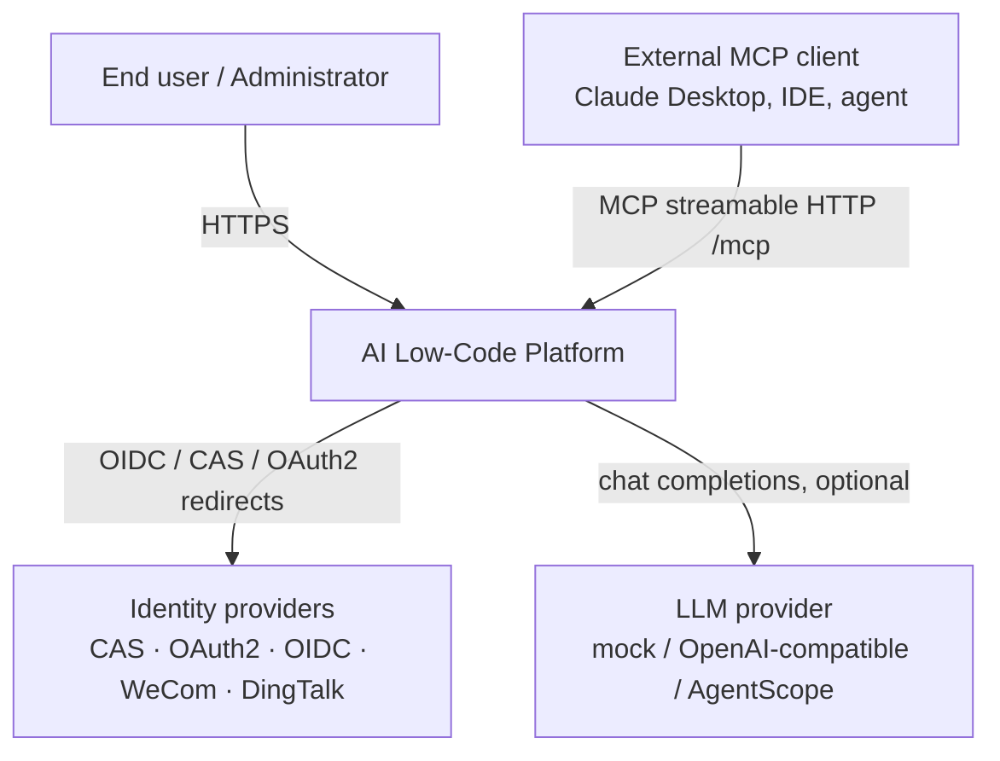
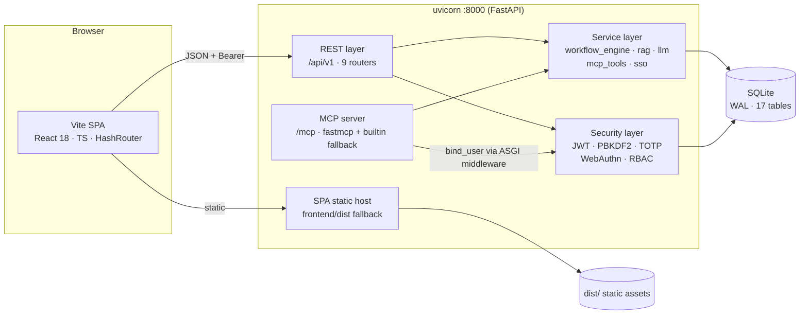
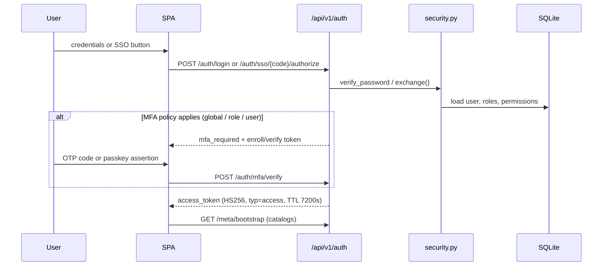
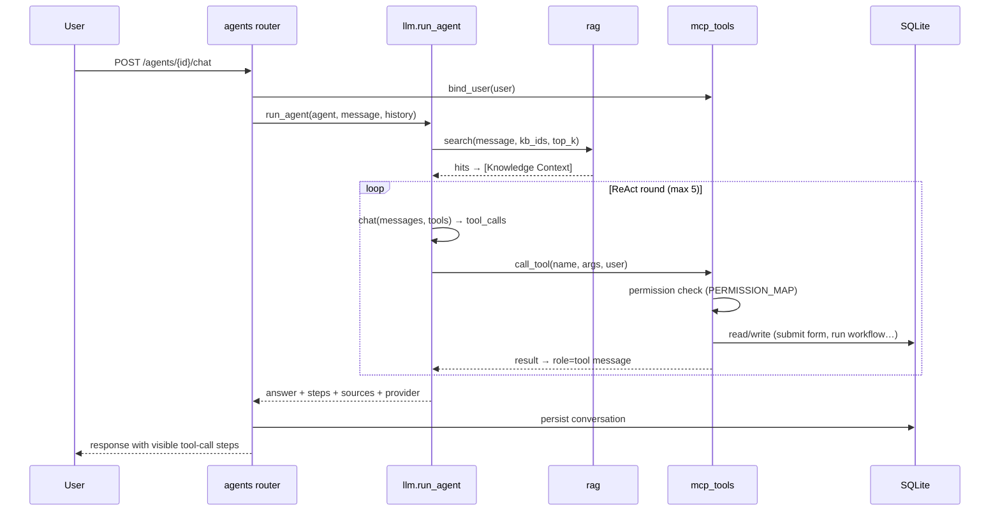

# System Architecture Design

| Field | Value |
| --- | --- |
| Document ID | `ARC-001` |
| Status | Baseline (implemented and verified) |
| Version | 1.0 |
| Applies to | `ai-lowcode-platform` v0.1.0 |
| Audience | Architects, backend/frontend engineers, SRE |
| 中文 | [architecture.zh-CN.md](architecture.zh-CN.md) |
| Related | [AI System Design](ai-design.md) · [Security Architecture](security.md) · [Data Model](data-model.md) · [API & MCP Reference](api-reference.md) · [ADR index](adr/README.md) |

## 1. Purpose and scope

This document describes the **as-built architecture** of the AI Low-Code Platform: a full-stack, front-end/back-end separated system that provides visual form design, visual DAG workflow orchestration, a versioned REST API, an MCP server with third-party skill registry, knowledge-grounded AI query/action agents, RBAC, five SSO protocols and role/user-scoped MFA.

**In scope:** system context, containers, backend/frontend components, runtime flows, data flow, deployment topology, cross-cutting concerns, quality attributes and evolution boundaries.

**Out of scope:** detailed AI algorithms (see [AI System Design](ai-design.md)), cryptographic/permission details (see [Security Architecture](security.md)), table-by-table schema (see [Data Model](data-model.md)), endpoint contracts (see [API & MCP Reference](api-reference.md)).

## 2. Goals, non-goals and constraints

| Goals | Non-goals |
| --- | --- |
| Fully runnable with zero external services (offline-first demo) | Distributed/multi-tenant production deployment |
| One source of truth for platform capabilities (single tool registry) | A hosted vector database or managed LLM service |
| Every mutation authorized (RBAC) and recorded (audit) | Real WebAuthn attestation hardware validation |
| Consistent UI with i18n (en/zh, default en) and system/light/dark theme | Native mobile applications |
| Single-port deployment for simple operations | Horizontal scaling / HA out of the box |

**Constraints:** Python 3.11+, Node 18+, `uv`, `pnpm`; SQLite standard library (WAL); `fastmcp` 4.x streamable HTTP; MIT license; no emoji in UI (SVG only).

## 3. Architectural principles

1. **One registry, three consumers.** Every capability exposed to an LLM is declared once in `backend/app/services/mcp_tools.py` (name, JSON Schema, permission, handler). The MCP server, the AI ReAct loop and `POST /api/v1/mcp/invoke` all call the same handlers. See [ADR-0002](adr/0002-single-tool-registry.md).
2. **Offline-first with graceful degradation.** The default `mock` LLM backend works without an API key; MCP falls back to a built-in JSON-RPC transport if `fastmcp` is unavailable. See [ADR-0003](adr/0003-offline-first-llm-runtime.md).
3. **Declarative authorization.** Every business route uses `Depends(require("resource:action"))`; tool calls re-check the same permission through the registry.
4. **Metadata-driven UI.** The frontend never hard-codes catalogs; `/meta/bootstrap` returns field types, node types, permissions, providers, agents runtime, i18n locales and themes in one call.
5. **Stateless request identity, local persistence.** JWT carries identity; SQLite holds state with WAL and a thread-local connection + write lock.

## 4. System context (C4 Level 1)



The platform is a **single deployable unit**: one FastAPI process serves the REST API, the MCP endpoint, OpenAPI docs and (in single-port mode) the built SPA.

## 5. Container view (C4 Level 2)



| Container | Responsibility | Technology |
| --- | --- | --- |
| SPA | All UI, visual designers, i18n, theming | Vite 6, React 18, TypeScript, Tailwind 3, shadcn/ui-style components, lucide-react |
| REST layer | 67 OpenAPI paths, Pydantic models, error semantics | FastAPI 0.128+, `APIRouter`, `Depends` |
| MCP server | MCP `initialize` / `tools/list` / `tools/call` / resources / prompts | `fastmcp` 4.1.6 `http_app(path="/mcp")`, builtin JSON-RPC fallback |
| Service layer | Pure business logic, no HTTP concerns | Python modules in `app/services/` |
| Security layer | Identity, tokens, password/MFA, permission checks | stdlib `hashlib`/`hmac`, HS256 JWT, `contextvars` |
| Persistence | All state | `sqlite3` (WAL, JSON columns, thread-local connection, write lock) |

## 6. Component view (C4 Level 3, backend)

```
app/
├── main.py            lifespan (init_db → seed → fastmcp lifespan), CORS,
│                      MCPAuthASGIMiddleware, router include, SPA catch-all
├── config.py          frozen Settings dataclass, dotenv (backend/.env + root .env)
├── db.py              schema, connection lifecycle, insert/update/delete/q/q1/scalar
├── security.py        password hash, JWT (access/mfa/enroll), TOTP, WebAuthn, MFA policy
├── deps.py            get_current_user, has_permission, require(), audit()
├── seed.py            deterministic first-boot demo data
├── mcp_server.py      fastmcp tools + dependency-free JSON-RPC fallback
├── routers/           auth · rbac · forms · workflows · knowledge · agents · mcp · audit · meta
└── services/
    ├── mcp_tools.py        ★ capability registry (12 tools, schemas, permissions)
    ├── workflow_engine.py  DAG validation (cycle detection), condition routing, execution
    ├── rag.py              mixed zh/en tokenizer, chunking, BM25, context assembly
    ├── llm.py              3 backends, ReAct orchestration, grounded answers
    └── sso.py              5 provider adapters, demo mode, identity provisioning
```

### 6.1 Request pipeline

```
HTTP → CORS → route match → Depends(get_current_user) → Depends(require(permission))
     → Pydantic validation → router → service → db (WAL) → audit() → JSON response
```

MCP requests take a parallel path: `MCPAuthASGIMiddleware` (pure ASGI) decodes the optional `Authorization: Bearer` header, calls `mcp_tools.bind_user(user)` via a `ContextVar`, then the fastmcp/builtin handler invokes `mcp_tools.call_tool()` which performs the same permission check.

### 6.2 Frontend composition

```
main.tsx → HashRouter · ThemeProvider · I18nProvider · ToastProvider · AppContext
         → App.tsx (auth guard, Splash) → AppShell (sidebar/header/user menu)
         → 12 page modules
```

`lib/api.ts` wraps `fetch` with JWT injection, `ApiError`, and a global `401 → logout` event. `AppContext` loads `/auth/me` + `/meta/bootstrap` once after login and exposes `can(permission)`.

## 7. Key runtime flows

### 7.1 Authentication with MFA and SSO



### 7.2 AI agent executing a real platform action



### 7.3 Workflow execution

`validate_graph()` enforces exactly one `start`, at least one `end`, known node types, valid edge endpoints and no cycles (DFS three-state). `run()` walks the DAG, evaluates `condition` nodes against context (`gt/gte/lt/lte/eq/ne/contains`), dispatches `form/approval/ai/knowledge/http/notification` nodes, and returns `{status, context, logs}` persisted to `workflow_instances`.

## 8. Data flow

| Flow | Path | Storage |
| --- | --- | --- |
| Form definition | Designer → `PUT /forms/{id}` → JSON `schema` column | `forms`, `form_submissions` |
| Workflow graph | Canvas → `PUT /workflows/{id}` → JSON `graph` column | `workflows`, `workflow_instances` |
| Knowledge | Document create → `rag.index_document()` → JSON `chunks` | `kb_collections`, `kb_documents` |
| Agent chat | Chat → `run_agent()` → conversation turns | `conversations`, `audit_logs` |
| MCP skill registry | External server config → sync → tool cache | `mcp_skills` |
| Configuration | `.env` → `Settings` → runtime overrides | `settings` |

All complex structures are stored as JSON text columns, transparently serialized by `db._enc/_dec` and `db.loads()`.

## 9. Deployment view

| Mode | Command | Ports | Use |
| --- | --- | --- | --- |
| Development | `./scripts/dev.sh` | `:8000` API + `:5173` Vite (proxy `/api`, `/mcp`) | HMR, fast iteration |
| Single-port | `./scripts/start.sh` | `:8000` only | Demo / simple deployment; FastAPI serves `frontend/dist` |
| API-only | `uvicorn app.main:app --port 8000` | `:8000` | Headless API + MCP consumers |

The SPA catch-all is registered unconditionally and resolves `dist/index.html` per request, so the backend can start before the frontend is built. Paths `/api`, `/mcp`, `/docs`, `/openapi.json` are protected from the fallback. `HashRouter` avoids server-side route configuration.

## 10. Cross-cutting concerns

| Concern | Implementation |
| --- | --- |
| i18n | 496 leaf keys per locale, default `en`, `localStorage`, `<html lang>` sync, English fallback |
| Theme | `system` (default) / `light` / `dark`, `prefers-color-scheme` listener, HSL CSS variables, `meta[theme-color]` |
| Audit | Every mutation → `audit_logs(actor, action, resource, detail, ip, level, created_at)` |
| Configuration | `python-dotenv` → frozen `Settings`; `settings` table for runtime overrides |
| Errors | `HTTPException` with 401 / 403 / 404 / 422; `ApiError` on the client; 401 triggers global logout |
| Observability | `/api/v1/meta/health`, `/meta/stats`, `/agents/meta/runtime`, `/mcp/status` |
| Testing | `backend/tests/smoke.py` — 47 end-to-end assertions; `pnpm typecheck`, `pnpm build`, `pnpm check:i18n`, `ruff check` |

## 11. Technology decisions (summary)

| Decision | Rationale | ADR |
| --- | --- | --- |
| Monorepo, front/back separation, uv + pnpm | Independent toolchains, one clone to run | [0001](adr/0001-monorepo-and-stack.md) |
| Single tool registry for MCP + Agent + REST | Prevents capability drift, one permission gate | [0002](adr/0002-single-tool-registry.md) |
| Offline-first LLM with 3 backends | Zero-config demo, upgradeable to real models | [0003](adr/0003-offline-first-llm-runtime.md) |
| SQLite + in-process BM25 | No external service, mixed zh/en retrieval | [0004](adr/0004-sqlite-and-local-bm25.md) |
| fastmcp primary + builtin fallback, ASGI auth binding | Real MCP compliance plus resilience | [0005](adr/0005-mcp-transport-and-auth.md) |
| RBAC + policy-driven MFA + demo SSO | Complete auth surface without external IdP | [0006](adr/0006-rbac-mfa-and-sso.md) |

## 12. Quality attributes and trade-offs

| Attribute | Current posture | Evolution path |
| --- | --- | --- |
| Availability | Single process, SQLite WAL | Multi-worker + Postgres, shared session store |
| Security | HS256 JWT, PBKDF2, per-route RBAC, audit | RS256/rotating keys, rate limiting, secret manager |
| AI accuracy | Deterministic mock + BM25 grounding | Real LLM, vector/embedding store, reranking |
| Scalability | In-process indexes, synchronous execution | Task queue for workflow runs, external vector DB |
| Testability | 47 smoke assertions, no network required | Contract tests, load tests, MCP conformance suite |
| Operability | Health/stats/runtime endpoints | Structured logging, metrics, tracing |

## 13. Known limitations

- SQLite and in-process BM25 are single-node; no cross-process index sharing.
- `mock` LLM uses regex intent detection — it is deterministic, not generative.
- WebAuthn uses challenge/credential binding without full attestation verification; `PASSKEY_ORIGIN` must match the deployment (HTTPS or localhost).
- SSO demo mode provisions local users without real IdP validation; production requires real credentials and TLS.
- The workflow engine executes synchronously in the request; long-running flows should move to a queue.

## 14. Traceability

| Requirement | Design element | Code |
| --- | --- | --- |
| Visual form design | Metadata-driven designer | `routers/forms.py`, `pages/Forms.tsx` |
| Visual workflow orchestration | DAG validator + engine | `services/workflow_engine.py`, `pages/Workflows.tsx` |
| REST API | Versioned routers | `routers/*.py` (84 route decorators → 67 OpenAPI paths) |
| MCP + third-party skills | Dual-transport MCP + registry | `mcp_server.py`, `routers/mcp.py` |
| AI query/act agents | ReAct + tool registry + RAG | `services/llm.py`, `services/rag.py` |
| Knowledge base | BM25 + chunking | `services/rag.py`, `routers/knowledge.py` |
| RBAC / SSO / MFA | Declarative guards + adapters | `deps.py`, `security.py`, `services/sso.py` |
| i18n / theme | Providers + bootstrap | `i18n/`, `theme/`, `routers/meta.py` |
