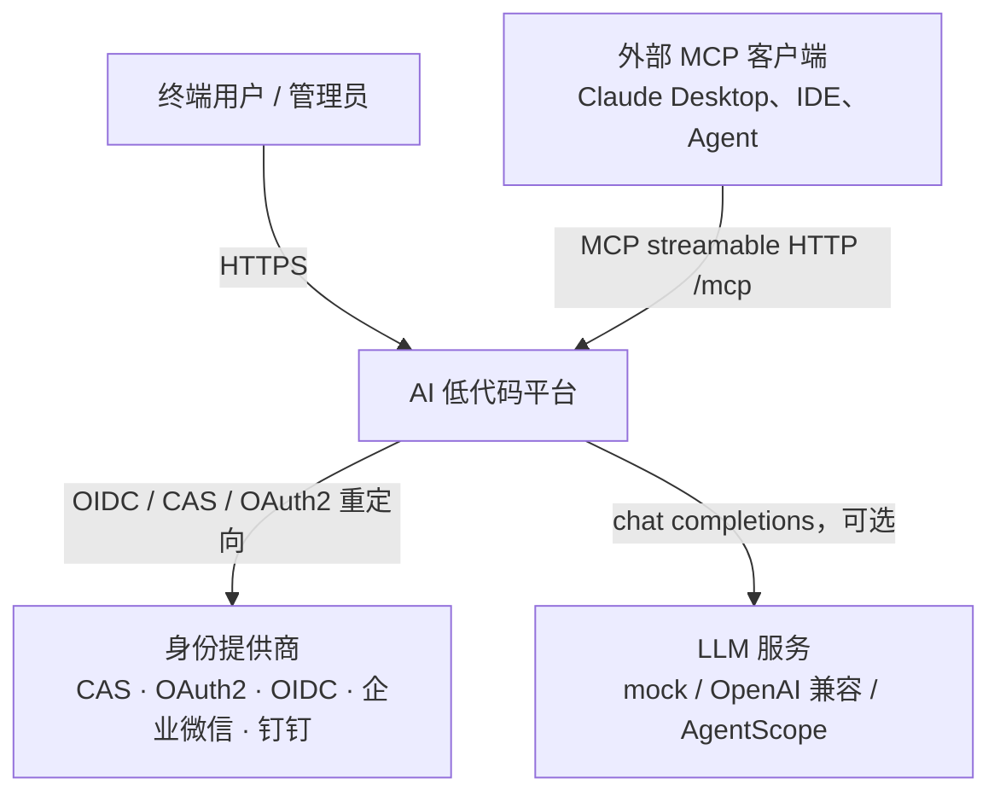
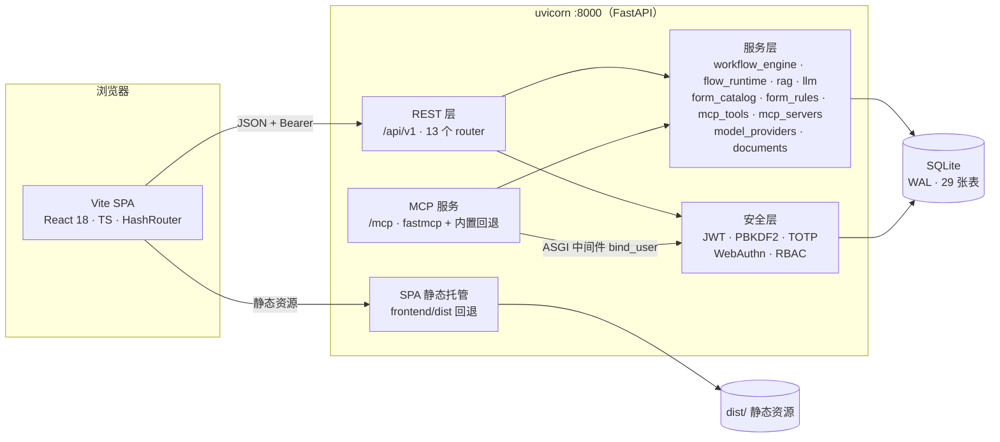
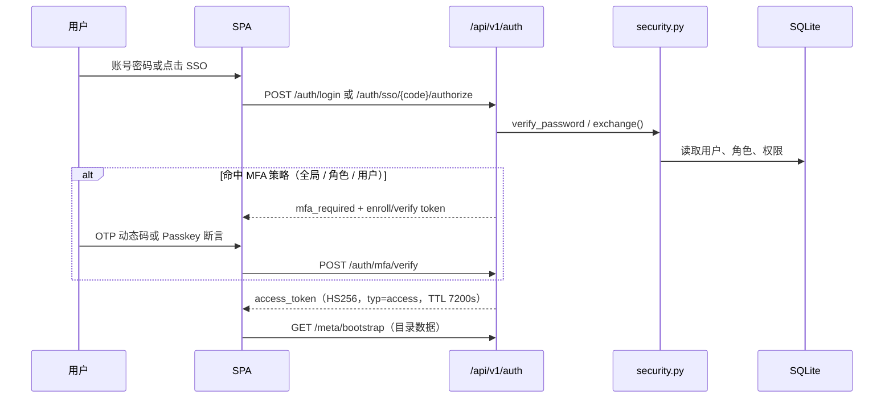
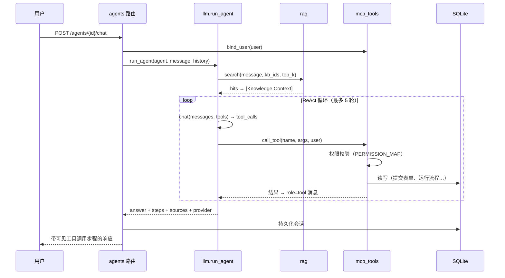

# 系统架构设计

| 项目 | 内容 |
| --- | --- |
| 文档编号 | `ARC-001` |
| 状态 | 基线（已实现并验证） |
| 版本 | 1.0 |
| 适用版本 | `ai-lowcode-platform` v0.1.0 |
| 读者 | 架构师、前后端工程师、运维 |
| English | [architecture.md](architecture.md) |
| 关联文档 | [AI 系统设计](ai-design.zh-CN.md) · [安全架构](security.md) · [数据模型](data-model.md) · [接口与 MCP 规范](api-reference.md) · [国内表单与审批规范](form-flow-domestic.md) · [ADR 索引](adr/README.md) |

## 1. 目的与范围

本文档描述 AI 低代码平台的**已落地架构**：一套前后端分离的全栈系统，提供**面向国内场景的表单引擎**（44 种字段、法定校验、公式沙箱、明细表、条件规则）、可视化 DAG 流程编排与**长时人工审批运行时**（会签、并行/汇聚、委托、任务动作）、版本化 REST API、**MCP 服务与技能两套独立注册表**、多类别 AI 模型配置、多格式知识库上传、带声明式资源绑定的基于知识库的 AI 查询/操作智能体、RBAC、五种 SSO 协议，以及可按角色/用户配置的多因子认证。国内增强详见 [FFC-001](form-flow-domestic.md) 与 [ADR-0009](adr/0009-domestic-forms-and-approval-runtime.md)。

**范围内**：系统上下文、容器视图、前后端组件、运行时流程、数据流、部署拓扑、横切关注点、质量属性与演进边界。

**范围外**：AI 算法细节见 [AI 系统设计](ai-design.zh-CN.md)，密码学与权限细节见 [安全架构](security.md)，逐表结构见 [数据模型](data-model.md)，端点契约见 [接口与 MCP 规范](api-reference.md)。

## 2. 目标、非目标与约束

| 目标 | 非目标 |
| --- | --- |
| 零外部依赖即可完整运行（离线优先演示） | 分布式 / 多租户生产部署 |
| 平台能力单一事实来源（统一工具注册表） | 托管向量库或托管 LLM 服务 |
| 所有写操作均经授权（RBAC）并记录审计 | 真实 WebAuthn 认证器 attestation 校验 |
| 界面风格一致，i18n 中英文（默认英文）、system/light/dark 主题 | 原生移动应用 |
| 单端口部署，运维简单 | 开箱即用的水平扩展 / 高可用 |

**约束**：Python 3.11+、Node 18+、`uv`、`pnpm`；SQLite 标准库（WAL）；`fastmcp` 4.x streamable HTTP；`python-multipart` 处理上传；纯标准库文档解析，可选 `pdftotext` / `tesseract`；MIT 协议；界面禁用 emoji（仅 SVG）。

## 3. 架构原则

1. **一处注册、三处消费。** 暴露给 LLM 的每个能力只在 `backend/app/services/mcp_tools.py` 声明一次（名称、JSON Schema、权限、handler）。MCP 服务、AI ReAct 循环与 `POST /api/v1/mcp/invoke` 调用同一批 handler。见 [ADR-0002](adr/0002-single-tool-registry.md)。
2. **离线优先、优雅降级。** 默认 `mock` LLM 后端无需 API Key；`fastmcp` 不可用时 MCP 自动回退到内置 JSON-RPC 传输。见 [ADR-0003](adr/0003-offline-first-llm-runtime.md)。
3. **声明式授权。** 每个业务路由使用 `Depends(require("resource:action"))`；工具调用通过注册表再次执行同一权限校验。
4. **元数据驱动 UI。** 前端不硬编码目录数据；`/meta/bootstrap` 一次返回字段类型、节点类型、权限、Provider、Agent 运行时、i18n 语言与主题。
5. **无状态请求身份 + 本地持久化。** JWT 承载身份；SQLite 以 WAL、线程局部连接与写锁保存状态。

## 4. 系统上下文（C4 Level 1）



平台是**单一可部署单元**：一个 FastAPI 进程同时提供 REST API、MCP 端点、OpenAPI 文档，以及（单端口模式下）构建后的 SPA。

## 5. 容器视图（C4 Level 2）



| 容器 | 职责 | 技术 |
| --- | --- | --- |
| SPA | 全部 UI、可视化设计器、i18n、主题 | Vite 6、React 18、TypeScript、Tailwind 3、shadcn/ui 风格组件、lucide-react |
| REST 层 | 134 个 OpenAPI 路径、Pydantic 模型、错误语义 | FastAPI 0.128+、`APIRouter`、`Depends` |
| MCP 服务 | `initialize` / `tools/list` / `tools/call` / resources / prompts | `fastmcp` 4.1.6 `http_app(path="/mcp")` + 内置 JSON-RPC 回退 |
| 服务层 | 纯业务逻辑，不感知 HTTP | `app/services/` 下 Python 模块 |
| 安全层 | 身份、令牌、密码/MFA、权限校验 | 标准库 `hashlib`/`hmac`、HS256 JWT、`contextvars` |
| 持久化 | 全部状态 | `sqlite3`（WAL、JSON 列、线程局部连接、写锁） |

## 6. 组件视图（C4 Level 3，后端）

```
app/
├── main.py            lifespan（init_db → seed → fastmcp lifespan）、CORS、
│                      MCPAuthASGIMiddleware、路由注册、SPA catch-all
├── config.py          冻结 Settings dataclass，dotenv（backend/.env + 根目录 .env）
├── db.py              schema、连接生命周期、insert/update/delete/q/q1/scalar
├── security.py        密码哈希、JWT（access/mfa/enroll）、TOTP、WebAuthn、MFA 策略
├── deps.py            get_current_user、has_permission、require()、audit()
├── seed.py            首次启动的确定性演示数据
├── mcp_server.py      fastmcp 工具 + 无依赖 JSON-RPC 回退
├── routers/           auth · rbac · forms · workflows · knowledge · agents · mcp
│                      mcp_servers · skills · ai_providers · audit · meta
└── services/
    ├── mcp_tools.py        ★ 能力注册表（20 工具、Schema、权限、Agent 工具域）
    ├── mcp_servers.py      MCP 服务注册表、探测/同步、外部工具桥接
    ├── model_providers.py  6 类 AI 模型配置、密钥脱敏、effective_llm()
    ├── documents.py        纯标准库多格式解析（OOXML/PDF/OCR/文本）
    ├── workflow_engine.py  DAG 校验（14 种节点）、条件组、同步 dry-run 执行
    ├── flow_runtime.py     ★ 长时审批：审批人规则、会签模式、任务、超时
    ├── form_catalog.py     ★ 5 组 44 种字段、校验器、运算符、函数
    ├── form_rules.py       ★ 法定校验、AST 公式沙箱、显隐规则、字段权限
    ├── rag.py              中英混合分词、分块、BM25、上下文拼装
    ├── llm.py              3 个后端、ReAct 编排、有据回答
    ├── data_scope.py       ★ 行级数据范围（all/audit/self）、归属过滤、row_visible()
    ├── notify.py           ★ 通知中心：站内收件箱 + Webhook/邮件渠道，emit() 永不抛错
    ├── notify.py           ★ 通知中心：站内收件箱 + Webhook/邮件渠道，emit() 永不抛错
    ├── agent_intents.py    ★ collect/tool/chat 意图规划、schema 驱动动作请求
    └── sso.py              5 种 Provider 适配、demo 模式、身份自动建号
```

### 6.1 请求管线

```
HTTP → CORS → 路由匹配 → Depends(get_current_user) → Depends(require(permission))
     → Pydantic 校验 → router → service → db（WAL）→ audit() → JSON 响应
```

MCP 请求走并行路径：纯 ASGI 的 `MCPAuthASGIMiddleware` 解析可选 `Authorization: Bearer`，通过 `ContextVar` 调用 `mcp_tools.bind_user(user)`，随后 fastmcp / 内置 handler 调用 `mcp_tools.call_tool()` 执行同一套权限校验。

### 6.2 前端组合

```
main.tsx → HashRouter · ThemeProvider · I18nProvider · ToastProvider · AppContext
         → App.tsx（鉴权守卫、Splash）→ AppShell（侧栏/顶栏/用户菜单）
         → 14 个页面模块
```

`lib/api.ts` 封装 `fetch`，统一注入 JWT、`ApiError` 与全局 `401 → 登出` 事件。`AppContext` 登录后一次性加载 `/auth/me` + `/meta/bootstrap`，并暴露 `can(permission)`。

共享组件 `components/SchemaForm.tsx` 在四处渲染后端 `FormField[]` schema：设计器发起弹窗、门户发起弹窗、公开分享页、智能体动态收集卡片，并调用 `/forms/{id}/evaluate` 获取显隐/权限/计算值。`pages/WorkflowPortal.tsx` 是重构后的工作流主页（目录 / 我发起的 / 待办审批）；`pages/StartWorkflow.tsx` 是公开 `/#/start/{code}` 落地页；`components/layout/NotificationBell.tsx` 顶栏通知铃铛（未读轮询 + 收件箱）；`pages/Profile.tsx` 个人中心（资料、密码、统计、组、委托、通知偏好）；`components/layout/NotificationBell.tsx` 顶栏通知铃铛（未读轮询 + 收件箱）；`pages/Profile.tsx` 个人中心（资料、密码、统计、组、委托、通知偏好）；`App.tsx` 将其注册为公开路由并用 `safeNext()` 完成登录回跳，`Workflows.tsx` 提供门户/设计器视图切换。

## 7. 关键运行时流程

### 7.1 认证（MFA 与 SSO）



### 7.2 AI 智能体执行真实平台操作



### 7.3 流程执行（同步 dry-run）

`validate_graph()` 强制校验：唯一 `start`、至少一个 `end`、节点类型合法、边端点存在、无环（DFS 三状态）。`run()` 按 DAG 遍历，依据上下文求值 `condition` 节点（`gt/gte/lt/lte/eq/ne/contains` 及条件组），分派 `form/approval/ai/knowledge/http/notification/cc/parallel/join/delay/subflow` 节点，返回 `{status, context, logs}` 并写入 `workflow_instances`。

### 7.4 国内长时审批实例

`POST /workflows/{id}/start` 创建实例时**固定 graph 快照**与 `workflow_version`，后续修改定义不会改变在途审批。`services/flow_runtime.py` 按 9 类规则解析审批人（`users`、`roles`、`departments`、`initiator`、`initiator_leader`、`leader_chain`、`form_field`、`previous`、`self_select`），应用生效的 `flow_delegations`，为「每人 × 每节点 × 每轮」生成一条 `flow_tasks`。`any` / `all` / `ratio` / `sequence` 四种会签方式决定节点完成条件，`parallel` + `join` 控制并发分支汇聚。每次 `act`（同意/驳回/退回/转交/加签）写入审计日志与时间线；`withdraw`、`urge`、`sweep_timeouts()` 覆盖撤回、催办与超时策略。`GET /workflows/instances/{id}/form-schema` 把绑定表单 schema 与当前节点 `field_permissions` 合并，`form_rules.validate_data()` 在服务端强制 `editable` / `readonly` / `hidden`。详见 [FFC-001](form-flow-domestic.md)。

### 7.5 认证分享链接与 schema 驱动的信息收集

宿主系统嵌入 `https://<host>/#/start/{code}`。第一阶段（匿名）调用**公开**的 `GET /workflows/share-info/{code}`，展示非敏感元数据与登录入口 `/#/login?next=/start/{code}`；`safeNext()` 拒绝开放重定向，`sessionStorage` 在真实 SSO 重载时保留 `next`。第二阶段（已登录）加载 `GET /workflows/{id}/start-schema` → `SchemaForm` → `POST /workflows/{id}/start`，并支持 `?data=<base64(json)>` 预填。认证前不暴露任何提交或实例数据。

智能体采用相同模式：`agent_intents.plan()` 返回带 `action_request` schema 的 `collect` 意图且**不产生副作用**；聊天界面渲染 `SchemaForm` 卡片，只有 `POST /agents/{id}/actions` 才真正执行。两条链路的业务读操作均经过 `data_scope.owner_clause()`。详见 [WFP-001](workflow-portal-and-data-scopes.md)。

## 8. 数据流

| 流程 | 路径 | 存储 |
| --- | --- | --- |
| 表单定义 | 设计器 → `PUT /forms/{id}` → JSON `schema` 列 | `forms`, `form_submissions` |
| 表单规则 / 版本 | `POST /forms/{id}/evaluate` → `form_rules` → 发布时快照 | `form_versions`, `form_submissions.computed` |
| 流程画布 | 画布 → `PUT /workflows/{id}` → JSON `graph` 列 | `workflows`, `workflow_instances` |
| 审批实例 | `POST /workflows/{id}/start` → `flow_runtime` → `/instances/.../act` | `workflow_versions`, `flow_tasks`, `flow_delegations`, `org_units` |
| 智能体聊天 | 聊天 → `agent_intents.plan()` → `run_agent()` / 自助工具 / 动态表单 → 会话轮次 | `conversations`, `audit_logs` |
| 门户与分享 | `/workflows/catalog` · `/mine/instances` → `/{id}/start-schema` → `/{id}/start` | `workflow_instances`, `form_submissions`, `flow_tasks` |
| 知识库（文本） | 创建文档 → `rag.index_document()` → JSON `chunks` | `kb_collections`, `kb_documents` |
| 知识库（上传） | Multipart → `documents.parse()` → `rag.index_document()` → 文件元数据 + 分块 | `kb_documents` |
| 智能体会话 | 对话 → `run_agent()`（按绑定收窄工具域）→ 会话轮次 | `conversations`, `audit_logs` |
| MCP 服务注册 | 服务配置 → 探测/同步 → 声明的工具 | `mcp_servers` |
| 技能注册 | 安装 → 生命周期 → 可编辑文件 → 可选 `server_id` 关联 | `mcp_skills`, `mcp_skill_files` |
| AI 模型服务 | `.env` 引导 → 类别默认项 → `effective_llm()` → 运行时覆盖；Settings 快捷卡片 + `/models` 完整管理 | `ai_providers` |
| 配置 | `.env` → `Settings` → 运行时覆盖 | `settings` |

复杂结构统一以 JSON 文本列存储，由 `db._enc/_dec` 与 `db.loads()` 透明序列化。

## 9. 部署视图

| 模式 | 命令 | 端口 | 用途 |
| --- | --- | --- | --- |
| 开发 | `./scripts/dev.sh` | `:8000` API + `:5173` Vite（代理 `/api`、`/mcp`） | 热更新、快速迭代 |
| 单端口 | `./scripts/start.sh` | 仅 `:8000` | 演示 / 简易部署，FastAPI 托管 `frontend/dist` |
| 纯 API | `uvicorn app.main:app --port 8000` | `:8000` | 无头 API + MCP 消费方 |

SPA catch-all 无条件注册，并在每次请求时解析 `dist/index.html`，因此后端可先于前端构建启动；`/api`、`/mcp`、`/docs`、`/openapi.json` 受保护不被回退。`HashRouter` 免去服务端路由配置。

## 10. 横切关注点

| 关注点 | 实现 |
| --- | --- |
| i18n | 每种语言 824 个叶子键，默认 `en`，`localStorage` 持久化，同步 `<html lang>`，缺失回退英文 |
| 主题 | `system`（默认）/ `light` / `dark`，监听 `prefers-color-scheme`，HSL CSS 变量，`meta[theme-color]` |
| 审计 | 所有写操作 → `audit_logs(actor, action, resource, detail, ip, level, created_at)` |
| 配置 | `python-dotenv` → 冻结 `Settings`；`settings` 表支持运行时覆盖 |
| 错误 | `HTTPException` 401 / 403 / 404 / 422；客户端 `ApiError`；401 触发全局登出 |
| 可观测 | `/api/v1/meta/health`、`/meta/stats`、`/agents/meta/runtime`、`/agents/meta/bindings`、`/mcp/status`、`/mcp/calls/stats`、`/knowledge/stats` |
| 测试 | `backend/tests/smoke.py` 205 项端到端断言；`pnpm typecheck`、`pnpm build`、`pnpm check:i18n`、`ruff check` |

## 11. 技术决策摘要

| 决策 | 理由 | ADR |
| --- | --- | --- |
| Monorepo、前后端分离、uv + pnpm | 工具链独立，一次 clone 即可运行 | [0001](adr/0001-monorepo-and-stack.md) |
| MCP / Agent / REST 共用工具注册表 | 避免能力漂移，统一权限闸口 | [0002](adr/0002-single-tool-registry.md) |
| 离线优先 LLM + 3 个后端 | 零配置演示，可升级真实模型 | [0003](adr/0003-offline-first-llm-runtime.md) |
| SQLite + 进程内 BM25 | 无外部服务，支持中英混合检索 | [0004](adr/0004-sqlite-and-local-bm25.md) |
| fastmcp 主通道 + 内置回退、ASGI 鉴权绑定 | 兼顾 MCP 合规与韧性 | [0005](adr/0005-mcp-transport-and-auth.md) |
| RBAC + 策略化 MFA + demo SSO | 不依赖外部 IdP 也具备完整认证面 | [0006](adr/0006-rbac-mfa-and-sso.md) |
| 技能生命周期、可编辑文件与调用日记 | 可审计的第三方能力管理 | [0007](adr/0007-mcp-skill-lifecycle-and-journal.md) |
| MCP 服务/技能拆分、AI 模型服务、知识库上传、智能体绑定 | 独立注册表与可配置的模型/知识资源 | [0008](adr/0008-mcp-skills-split-model-providers-and-knowledge-upload.md) |
| 国内表单引擎 + 长时人工审批运行时 | 不引入逐字段关系表即可覆盖国内企业/政务表单与审批场景 | [0009](adr/0009-domestic-forms-and-approval-runtime.md) |
| 集中式数据范围、门户、认证分享链接、schema 驱动智能体动作 | 授权单一真源、四处复用同一 schema、人工确认前不产生副作用 | [0010](adr/0010-data-scopes-portal-and-agent-actions.md) |

## 12. 质量属性与取舍

| 属性 | 当前姿态 | 演进路径 |
| --- | --- | --- |
| 可用性 | 单进程、SQLite WAL | 多 worker + Postgres、共享会话存储 |
| 安全性 | HS256 JWT、PBKDF2、逐路由 RBAC、审计 | RS256 / 密钥轮换、限流、密钥管理 |
| AI 准确性 | 确定性 mock + BM25 有据回答 | 真实 LLM、向量库、重排序 |
| 可扩展性 | 进程内索引、同步执行 | 流程任务队列、外部向量库 |
| 可测试性 | 205 项冒烟断言，无需网络 | 契约测试、压力测试、MCP 一致性套件 |
| 可运维性 | health / stats / runtime 端点 | 结构化日志、指标、链路追踪 |

## 13. 已知限制

- SQLite 与进程内 BM25 为单节点，索引不跨进程共享。
- `mock` LLM 使用正则意图识别，是确定性逻辑而非生成式模型。
- WebAuthn 采用 challenge / credential 绑定，未做完整 attestation 校验；`PASSKEY_ORIGIN` 必须与部署一致（HTTPS 或 localhost）。
- SSO demo 模式不经过真实 IdP 校验即自动建号；生产需配置真实凭据与 TLS。
- **同步** `/run` dry-run 仍在请求内执行；真实人工审批使用持久化的长时实例，但 `subflow`、`delay`、`signature`/`attachment` 文件存储与 GB/T 2260 省市区样例仍为模拟或简化实现（见 [FFC-001 §7](form-flow-domestic.md)）。超长流程的生产路径仍是任务队列。

## 14. 需求可追溯性

| 需求 | 设计要素 | 代码 |
| --- | --- | --- |
| 可视化表单设计 | 元数据驱动设计器 | `routers/forms.py`, `pages/Forms.tsx` |
| 国内表单增强（FFC-001） | 44 字段目录、法定校验、AST 公式、版本、打印/CSV | `services/form_catalog.py`, `services/form_rules.py`, `routers/forms.py`, `pages/Forms.tsx` |
| 可视化流程编排 | DAG 校验器 + 执行引擎 | `services/workflow_engine.py`, `pages/Workflows.tsx` |
| 人工审批运行时（ADR-0009） | 长时实例、会签、并行/汇聚、任务动作、委托 | `services/flow_runtime.py`, `routers/workflows.py`, `pages/Workflows.tsx` |
| REST API | 版本化路由 | `routers/*.py`（174 个路由装饰器 → 134 个 OpenAPI 路径） |
| MCP 传输 + 工具注册表 | 双传输 MCP + 单一注册表 | `mcp_server.py`, `routers/mcp.py`, `services/mcp_tools.py` |
| MCP 服务（独立） | CRUD、探测/同步、声明工具、远程调用 | `routers/mcp_servers.py`, `services/mcp_servers.py`, `mcp_servers` |
| 技能（独立） | 生命周期、目录、可编辑文件、`server_id` 关联 | `routers/skills.py`, `services/skill_*.py`, `mcp_skills` |
| AI 查询/操作智能体 | ReAct + 绑定工具域 + RAG + 意图规划/动态表单 | `services/llm.py`, `services/rag.py`, `services/agent_intents.py` |
| 数据范围 / 审计管理员 | all / audit / self 归属过滤 + 只读防御层 | `services/data_scope.py`, `deps.py` |
| 智能体资源绑定 | `GET /agents/meta/bindings`、创建/更新时清理失效 id | `routers/agents.py`, `pages/Agents.tsx` |
| AI 模型服务 | 6 个类别、密钥只写、运行时 LLM 覆盖 | `routers/ai_providers.py`, `services/model_providers.py`, `ai_providers` |
| 知识库 | BM25 + 分块 + 多格式上传 | `services/rag.py`, `services/documents.py`, `routers/knowledge.py` |
| RBAC / SSO / MFA | 声明式守卫 + 适配器 | `deps.py`, `security.py`, `services/sso.py` |
| i18n / 主题 | Provider + bootstrap | `i18n/`, `theme/`, `routers/meta.py` |
