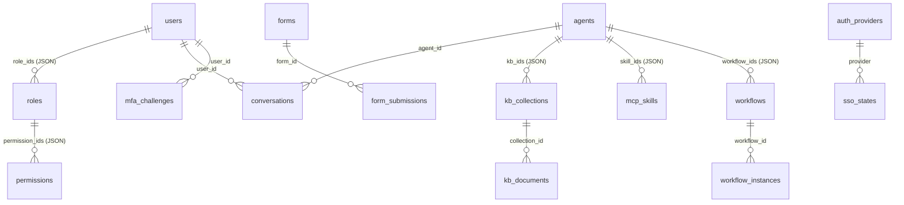

# Data Model

| Field | Value |
| --- | --- |
| Document ID | `DAT-001` |
| Status | Baseline (implemented and verified) |
| Version | 1.0 |
| Applies to | `ai-lowcode-platform` v0.1.0 |
| Source of truth | `backend/app/db.py::SCHEMA` |
| Related | [System Architecture](architecture.md) · [Security Architecture](security.md) · [API & MCP Reference](api-reference.md) · [ADR-0004](adr/0004-sqlite-and-local-bm25.md) |

> 中文摘要：平台使用单文件 SQLite（WAL 模式），共 **17 张表、4 个索引**，复杂结构统一以 JSON 文本列存储并由 `insert/update/loads` 透明序列化；连接采用线程局部对象 + 可重入写锁。首次启动自动灌入确定性演示数据。详见 [系统架构设计](architecture.zh-CN.md)。

## 1. Storage strategy

| Property | Implementation |
| --- | --- |
| Engine | `sqlite3` (Python standard library), single file `backend/data/platform.db` |
| Journal | `PRAGMA journal_mode=WAL` |
| Constraints | `PRAGMA foreign_keys=ON`, `PRAGMA busy_timeout=5000`, connect timeout 30 s |
| Row factory | `sqlite3.Row` (dict-like access) |
| Connections | `threading.local()` — one connection per thread |
| Concurrency | `threading.RLock()` guards all writes |
| JSON columns | TEXT columns serialized by `_enc`/`_dec`; read via `db.loads(row, *cols)` |
| Timestamps | UTC ISO-8601 seconds via `db.now()` |
| IDs | `INTEGER PRIMARY KEY AUTOINCREMENT`; `db.uid()` for opaque tokens |

`config.Settings.resolved_db_path` creates the parent directory on first use, so a fresh clone with only `backend/data/.gitkeep` starts cleanly.

## 2. Entity relationship overview

> JSON-array columns represent logical relationships; SQLite foreign keys are declared where a scalar FK column exists (`form_id`, `workflow_id`, `collection_id`).

## 3. Tables (17)

### 3.1 Identity & access (6)

| Table | Key columns | Notes |
| --- | --- | --- |
| `users` | `id`, `username` (unique), `email`, `display_name`, `avatar`, `password_hash`, `status`, `dept`, `role_ids` **JSON**, `otp_secret`, `otp_enabled`, `passkey_enabled`, `passkeys` **JSON**, `external_id`, `provider`, `last_login_at`, `created_at`, `updated_at` | Password stored as `pbkdf2_sha256$180000$…`; MFA credentials kept here |
| `roles` | `id`, `code` (unique), `name`, `description`, `permission_ids` **JSON**, `builtin`, `mfa_required`, `created_at` | Built-ins: admin / developer / operator / viewer |
| `permissions` | `id`, `code` (unique), `name`, `resource`, `action`, `description` | 25 rows |
| `auth_providers` | `id`, `code` (unique), `type`, `name`, `enabled`, `config` **JSON**, `sort_order`, timestamps | CAS / OAuth2 / OIDC / WeCom / DingTalk |
| `sso_states` | `state` (PK), `provider`, `redirect_uri`, `nonce`, `created_at` | CSRF/nonce state for SSO handshakes |
| `mfa_challenges` | `id`, `user_id`, `kind`, `challenge`, `payload` **JSON**, `expires_at`, `consumed`, `created_at` | One-time WebAuthn/MFA challenges |

### 3.2 Forms (2)

| Table | Key columns | Notes |
| --- | --- | --- |
| `forms` | `id`, `code` (unique), `name`, `description`, `status` (`draft`/`published`/`archived`), `schema` **JSON**, `layout` **JSON**, `version`, `created_by`, timestamps | Designer field definitions live in `schema` |
| `form_submissions` | `id`, `form_id`, `data` **JSON**, `status`, `submitted_by`, `created_at` | Indexed by `form_id` |

### 3.3 Workflows (2)

| Table | Key columns | Notes |
| --- | --- | --- |
| `workflows` | `id`, `code` (unique), `name`, `description`, `status`, `graph` **JSON** (`{nodes, edges}`), `version`, `created_by`, timestamps | DAG definition |
| `workflow_instances` | `id`, `workflow_id`, `status`, `context` **JSON**, `logs` **JSON**, `started_by`, `started_at`, `finished_at` | Indexed by `workflow_id` |

### 3.4 Knowledge base (2)

| Table | Key columns | Notes |
| --- | --- | --- |
| `kb_collections` | `id`, `code` (unique), `name`, `description`, `embedding_model` (default `bm25-local`), `chunk_size` (default 480), `created_by`, `created_at` | Retrieval scope for agents |
| `kb_documents` | `id`, `collection_id`, `title`, `content`, `source`, `status` (`indexed`), `chunks` **JSON**, `created_at` | `rag.index_document()` fills `chunks`; indexed by `collection_id` |

### 3.5 AI (2)

| Table | Key columns | Notes |
| --- | --- | --- |
| `agents` | `id`, `code` (unique), `name`, `description`, `mode` (`query`/`act`/`hybrid`), `model`, `system_prompt`, `temperature`, `kb_ids` **JSON**, `skill_ids` **JSON**, `workflow_ids` **JSON**, `status`, `created_by`, timestamps | Bindings are JSON arrays |
| `conversations` | `id`, `agent_id`, `title`, `messages` **JSON**, `user_id`, `created_at` | Last 6 turns replayed into the ReAct prompt |

### 3.6 MCP & system (3)

| Table | Key columns | Notes |
| --- | --- | --- |
| `mcp_skills` | `id`, `code` (unique), `name`, `type` (`http`/`sse`/`stdio`), `endpoint`, `command`, `enabled`, `auth_config` **JSON**, `tools` **JSON**, `health`, `last_sync_at`, `created_at` | Third-party MCP server registry |
| `audit_logs` | `id`, `actor`, `action`, `resource`, `detail` **JSON**, `ip`, `level`, `created_at` | Indexed by `created_at DESC` |
| `settings` | `key` (PK), `value` **JSON**, `updated_at` | Runtime overrides (MFA policy, i18n/theme defaults) |

## 4. Indexes (4)

| Index | Column | Purpose |
| --- | --- | --- |
| `idx_submissions_form` | `form_submissions(form_id)` | Submission listing per form |
| `idx_instances_wf` | `workflow_instances(workflow_id)` | Instance listing per workflow |
| `idx_kbdocs_collection` | `kb_documents(collection_id)` | Collection-scoped retrieval |
| `idx_audit_created` | `audit_logs(created_at DESC)` | Recent-activity queries |

## 5. Data access API

| Helper | Semantics |
| --- | --- |
| `init_db()` | Execute `SCHEMA` inside a transaction |
| `is_empty()` | Used by `seed_if_empty()` to decide first boot |
| `insert(table, data)` | JSON-encodes values, returns `lastrowid` |
| `update(table, id, data)` | JSON-encodes, `WHERE id=?` |
| `delete(table, id)` | `WHERE id=?` |
| `q(sql, params)` | Return all rows |
| `q1(sql, params)` | Return first row or `None` |
| `scalar(sql, params)` | Return single value |
| `loads(row, *cols)` | Decode JSON columns back into Python objects |
| `run(sql, params)` | Execute under the write lock |

## 6. Seed data (`seed.py`)

`seed_if_empty()` runs once on first boot and creates: 25 permissions, 4 roles, 4 users (`admin`, `alice`, `bob`, `carol`), 5 SSO providers (CAS enabled in demo mode), sample forms and submissions, workflows and instances, knowledge collections/documents, MCP skills, agents, conversations, settings and audit logs. Admin is created with `mfa_required=0` and MFA defaults off, so the demo is immediately usable.

## 7. Migration notes

- Schema is created idempotently with `CREATE TABLE IF NOT EXISTS`; there is no migration framework.
- Adding a column requires an explicit `ALTER TABLE` migration step (not shipped in v0.1.0).
- For production, replace SQLite with Postgres and map JSON columns to `JSONB`; the data access helpers are the single integration seam.
- `backend/data/*.db*` is git-ignored; only `.gitkeep` is committed.
