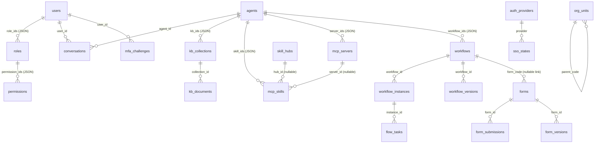

# Data Model

| Field | Value |
| --- | --- |
| Document ID | `DAT-001` |
| Status | Baseline (implemented and verified) |
| Version | 1.0 |
| Applies to | `ai-lowcode-platform` v0.1.0 |
| Source of truth | `backend/app/db.py::SCHEMA` |
| Related | [System Architecture](architecture.md) · [Security Architecture](security.md) · [API & MCP Reference](api-reference.md) · [Domestic Form & Approval](form-flow-domestic.md) · [ADR-0004](adr/0004-sqlite-and-local-bm25.md) · [ADR-0009](adr/0009-domestic-forms-and-approval-runtime.md) |

> 中文摘要：平台使用单文件 SQLite（WAL 模式），共 **29 张表、20 个索引**，复杂结构统一以 JSON 文本列存储并由 `insert/update/loads` 透明序列化；连接采用线程局部对象 + 可重入写锁，`init_db()` 内置幂等的 `ALTER TABLE` 惰性迁移。国内表单/审批增强新增 `form_versions`、`workflow_versions`、`flow_tasks`、`flow_delegations`、`org_units` 五张表；组/标签与通知新增 `user_groups`、`notifications`、`notify_prefs` 三张表；组/标签与通知新增 `user_groups`、`notifications`、`notify_prefs` 三张表；组/标签与通知新增 `user_groups`、`notifications`、`notify_prefs` 三张表，并扩展 `forms` / `form_submissions` / `workflows` / `workflow_instances` 的列，详见 [国内表单与审批规范](form-flow-domestic.md)。首次启动自动灌入确定性演示数据。详见 [系统架构设计](architecture.zh-CN.md)。

## 1. Storage strategy

| Property | Implementation |
| --- | --- |
| Engine | `sqlite3` (Python standard library), single file `backend/data/platform.db` |
| Journal | `PRAGMA journal_mode=WAL` |
| Constraints | `PRAGMA foreign_keys=ON`, `PRAGMA busy_timeout=5000`, connect timeout 30 s |
| Row factory | `sqlite3.Row` (dict-like access) |
| Connections | `threading.local()` — one connection per thread |
| Concurrency | `threading.RLock()` guards all writes |
| JSON columns | TEXT columns serialized by `_enc`/`_dec`; read via `db.loads(row, *cols)` |
| Timestamps | UTC ISO-8601 seconds via `db.now()` |
| IDs | `INTEGER PRIMARY KEY AUTOINCREMENT`; `db.uid()` for opaque tokens |

`config.Settings.resolved_db_path` creates the parent directory on first use, so a fresh clone with only `backend/data/.gitkeep` starts cleanly.

## 2. Entity relationship overview

> JSON-array columns represent logical relationships; SQLite foreign keys are declared where a scalar FK column exists (`form_id`, `workflow_id`, `collection_id`).

## 3. Tables (30)

### 3.1 Identity & access (6)

| Table | Key columns | Notes |
| --- | --- | --- |
| `users` | `id`, `username` (unique), `email`, `display_name`, `avatar`, `password_hash`, `status`, `dept`, `tags` **JSON**, `role_ids` **JSON**, `otp_secret`, `otp_enabled`, `passkey_enabled`, `passkeys` **JSON**, `external_id`, `provider`, `last_login_at`, `created_at`, `updated_at` | Password stored as `pbkdf2_sha256$180000$…`; MFA credentials kept here |
| `roles` | `id`, `code` (unique), `name`, `description`, `permission_ids` **JSON**, `builtin`, `mfa_required`, `created_at` | Built-ins: admin / developer / operator / viewer |
| `permissions` | `id`, `code` (unique), `name`, `resource`, `action`, `description` | 25 rows |
| `auth_providers` | `id`, `code` (unique), `type`, `name`, `enabled`, `config` **JSON**, `sort_order`, timestamps | CAS / OAuth2 / OIDC / WeCom / DingTalk |
| `sso_states` | `state` (PK), `provider`, `redirect_uri`, `nonce`, `created_at` | CSRF/nonce state for SSO handshakes |
| `mfa_challenges` | `id`, `user_id`, `kind`, `challenge`, `payload` **JSON**, `expires_at`, `consumed`, `created_at` | One-time WebAuthn/MFA challenges |

### 3.2 Forms & versions (3)

| Table | Key columns | Notes |
| --- | --- | --- |
| `forms` | `id`, `code` (unique), `name`, `description`, `status` (`draft`/`published`/`archived`), `schema` **JSON**, `layout` **JSON**, `version`, `print_template` **JSON**, `settings` **JSON**, `created_by`, timestamps | Designer field definitions live in `schema`; `settings` holds serial/region/print config |
| `form_submissions` | `id`, `form_id`, `data` **JSON**, `status`, `submitted_by`, `created_at`, `form_version`, `serial_no`, `flow_instance_id`, `computed` **JSON**, `updated_at` | `computed` caches formulas, RMB-in-words, identity parsing and detail summaries; indexed by `form_id` and `(form_id, serial_no)` |
| `form_versions` | `id`, `form_id`, `version`, `schema` **JSON**, `layout` **JSON**, `print_template` **JSON**, `settings` **JSON**, `note`, `created_by`, `created_at` | Immutable definition snapshots, auto-written on create/update/publish; `POST /forms/{id}/versions` restores one |

### 3.3 Workflows, approval tasks & organization (6)

| Table | Key columns | Notes |
| --- | --- | --- |
| `workflows` | `id`, `code` (unique), `name`, `description`, `status`, `graph` **JSON** (`{nodes, edges}`), `version`, `form_code` (nullable link), `created_by`, timestamps | DAG definition; `form_code` binds a form for approval instances |
| `workflow_instances` | `id`, `workflow_id`, `status`, `context` **JSON**, `logs` **JSON**, `started_by`, `started_at`, `finished_at`, `graph` **JSON** (pinned snapshot), `form_data` **JSON**, `form_code`, `current_nodes` **JSON**, `variables` **JSON**, `workflow_version` | Long-running approval state; indexed by `workflow_id` |
| `workflow_versions` | `id`, `workflow_id`, `version`, `graph` **JSON**, `form_code`, `note`, `created_by`, `created_at` | Graph snapshots pinned by running instances |
| `flow_tasks` | `id`, `instance_id`, `node_id`, `node_name`, `node_type`, `assignee`, `seq`, `status` (`pending`/`approved`/`rejected`/`skipped`/…), `decision`, `comment`, `signature`, `due_at`, `acted_at`, `created_at`, `delegated_from`, `round` | One row per assignee per node activation; `round` supports re-review after a return |
| `flow_delegations` | `id`, `principal`, `agent`, `enabled`, `start_at`, `end_at`, `reason`, `created_by`, `created_at` | Principal → agent delegation applied when tasks are created |
| `user_groups` | `id`, `code` (unique), `name`, `description`, `members` **JSON**, `tags` **JSON**, `enabled`, `created_by`, `created_at` | Free-form member pools for the `groups` approver rule |
| `notifications` | `id`, `recipient`, `event`, `title`, `body`, `ref_type`, `ref_id`, `read_at`, `created_at` | Per-recipient in-app notification inbox |
| `notify_prefs` | `id`, `username` (unique), `events` **JSON**, `updated_at` | Per-user event → delivery-channels map |
| `user_groups` | `id`, `code` (unique), `name`, `description`, `members` **JSON**, `tags` **JSON**, `enabled`, `created_by`, `created_at` | Free-form member pools for the `groups` approver rule |
| `notifications` | `id`, `recipient`, `event`, `title`, `body`, `ref_type`, `ref_id`, `read_at`, `created_at` | Per-recipient in-app notification inbox |
| `notify_prefs` | `id`, `username` (unique), `events` **JSON**, `updated_at` | Per-user event → delivery-channels map |
| `user_groups` | `id`, `code` (unique), `name`, `description`, `members` **JSON**, `tags` **JSON**, `enabled`, `created_by`, `created_at` | Free-form member pools for the `groups` approver rule |
| `notifications` | `id`, `recipient`, `event`, `title`, `body`, `ref_type`, `ref_id`, `read_at`, `created_at` | Per-recipient in-app notification inbox |
| `notify_prefs` | `id`, `username` (unique), `events` **JSON**, `updated_at` | Per-user event → delivery-channels map |
| `org_units` | `id`, `code` (unique), `name`, `parent_code`, `level`, `leader`, `sort_order` | Minimal department hierarchy for `initiator_leader` / `leader_chain` approver rules |

### 3.4 Knowledge base (2)

| Table | Key columns | Notes |
| --- | --- | --- |
| `kb_collections` | `id`, `code` (unique), `name`, `description`, `embedding_model` (default `bm25-local`), `chunk_size` (default 480), `created_by`, `created_at` | Retrieval scope for agents |
| `kb_documents` | `id`, `collection_id`, `title`, `content`, `source`, `status` (`indexed`/`empty`), `chunks` **JSON**, `file_name`, `file_type`, `file_size`, `parse_status` (`manual`/`parsed`/`ocr`/`empty`/`error`), `parse_error`, `created_at` | Uploaded Office/PDF/Markdown files are parsed by `services/documents.py`; `rag.index_document()` fills `chunks`; indexed by `collection_id` + `file_type` |

### 3.5 AI (2)

| Table | Key columns | Notes |
| --- | --- | --- |
| `agents` | `id`, `code` (unique), `name`, `description`, `mode` (`query`/`act`/`hybrid`), `model`, `system_prompt`, `temperature`, `kb_ids` **JSON**, `skill_ids` **JSON**, `server_ids` **JSON**, `workflow_ids` **JSON**, `status`, `created_by`, timestamps | Four independent binding arrays; `server_ids` restricts the ReAct tool set to declared MCP server tools |
| `conversations` | `id`, `agent_id`, `title`, `messages` **JSON**, `user_id`, `created_at` | One chat session per row, grouped by `agent_id`; last 6 turns replayed into the ReAct prompt. An empty row (title `''`, `messages=[]`) represents an explicitly started session and is titled from the first message |

### 3.6 MCP servers, Skills, Hubs, AI models & system (8)

| Table | Key columns | Notes |
| --- | --- | --- |
| `mcp_servers` | `id`, `code` (unique), `name`, `description`, `transport` (`builtin`/`http`/`sse`/`stdio`), `endpoint`, `command`, `auth_config` **JSON**, `tools` **JSON**, `enabled`, `health`, `last_sync_at`, `status`, `source`, `created_by`, timestamps | Independent MCP connection registry; enabled servers contribute tools |
| `mcp_skills` | `id`, `code` (unique), `name`, `type`, `endpoint`, `command`, `enabled`, `status` (`installed`/`disabled`/`uninstalled`/`error`), `version`, `source`, `description`, `manifest` **JSON**, `auth_config` **JSON**, `tools` **JSON**, `health`, `last_sync_at`, `installed_at`, `server_id` (nullable informational link), `hub_id` (nullable), timestamps | Independent Skill registry + lifecycle state; `source=hub:*` records Hub provenance |
| `mcp_call_logs` | `id`, `request_id`, `method`, `tool`, `source` (`mcp`/`rest`/`agent`/`internal`), `transport`, `actor`, `arguments` **JSON**, `status`, `error`, `result_preview`, `target`, `duration_ms`, `created_at` | Every tool invocation and JSON-RPC method; `target` records `server:<code>` |
| `mcp_skill_files` | `id`, `skill_id`, `path` (unique per skill), `content`, `language`, `size`, `updated_at` | Editable skill files; mirrored to `data/skills/<code>/` |
| `ai_providers` | `id`, `code` (unique), `name`, `category` (`llm`/`asr`/`tts`/`embedding`/`rerank`/`vision`), `vendor`, `base_url`, `api_key`, `model`, `enabled`, `is_default`, `config` **JSON**, `description`, timestamps | Runtime model-service configs; `api_key` never returned in full; `config.env_managed` marks rows still bootstrapped from `.env` |
| `audit_logs` | `id`, `actor`, `action`, `resource`, `detail` **JSON**, `ip`, `level`, `created_at` | Indexed by `created_at DESC` |
| `settings` | `key` (PK), `value` **JSON**, `updated_at` | Runtime overrides (MFA policy, i18n/theme defaults, `registry.custom_types` for runtime-registered component/node specs) |
| `skill_hubs` | `id`, `code` (unique), `name`, `description`, `kind` (`builtin`/`remote`), `url`, `enabled`, `sync_interval_min`, `auth_config` **JSON**, `last_sync_at`, `index_cache` **JSON**, timestamps | Skill registries; builtin hubs work offline, remote hubs cache their index and degrade to it on failure |

## 4. Indexes (22)

| Index | Column | Purpose |
| --- | --- | --- |
| `idx_submissions_form` | `form_submissions(form_id)` | Submission listing per form |
| `idx_instances_wf` | `workflow_instances(workflow_id)` | Instance listing per workflow |
| `idx_kbdocs_collection` | `kb_documents(collection_id)` | Collection-scoped retrieval |
| `idx_audit_created` | `audit_logs(created_at DESC)` | Recent-activity queries |
| `idx_mcp_calls_created` | `mcp_call_logs(created_at DESC)` | Journal pagination / recent calls |
| `idx_mcp_calls_tool` | `mcp_call_logs(tool)` | Per-tool aggregation and filters |
| `idx_skill_files_skill` | `mcp_skill_files(skill_id)` | Skill file listing |
| `idx_ai_providers_category` | `ai_providers(category, is_default)` | Default provider lookup per category |
| `idx_mcp_servers_enabled` | `mcp_servers(enabled)` | Enabled-server tool discovery |
| `idx_kbdocs_file_type` | `kb_documents(file_type)` | Upload format aggregation |
| `idx_form_versions_form` | `form_versions(form_id, version DESC)` | Version listing / restore |
| `idx_wf_versions_wf` | `workflow_versions(workflow_id, version DESC)` | Graph version listing |
| `idx_flow_tasks_instance` | `flow_tasks(instance_id, round)` | Instance task + timeline queries |
| `idx_flow_tasks_assignee` | `flow_tasks(assignee, status)` | Personal task center |
| `idx_flow_delegations_principal` | `flow_delegations(principal, enabled)` | Active delegation lookup at task creation |
| `idx_user_groups_code` | `user_groups(code)` | Group lookup by code in approver resolution |
| `idx_notifications_recipient` | `notifications(recipient, read_at)` | Inbox list and unread counter |
| `idx_notifications_created` | `notifications(created_at DESC)` | Newest-first inbox ordering |
| `idx_org_units_parent` | `org_units(parent_code)` | Leader-chain traversal |
| `idx_submissions_serial` | `form_submissions(form_id, serial_no)` | Serial-number uniqueness / lookup |
| `idx_skill_hubs_enabled` | `skill_hubs(enabled)` | Enabled-hub lookup for cross-hub search |
| `idx_conversations_agent_user` | `conversations(agent_id, user_id)` | Grouped session list / per-agent clear |

## 5. Data access API

| Helper | Semantics |
| --- | --- |
| `init_db()` | Execute `SCHEMA` inside a transaction |
| `is_empty()` | Used by `seed_if_empty()` to decide first boot |
| `insert(table, data)` | JSON-encodes values, returns `lastrowid` |
| `update(table, id, data)` | JSON-encodes, `WHERE id=?` |
| `delete(table, id)` | `WHERE id=?` |
| `q(sql, params)` | Return all rows |
| `q1(sql, params)` | Return first row or `None` |
| `scalar(sql, params)` | Return single value |
| `loads(row, *cols)` | Decode JSON columns back into Python objects |
| `run(sql, params)` | Execute under the write lock |

## 6. Seed data (`seed.py`)

`seed_if_empty()` runs once on first boot and creates: 28 permissions, 5 roles, 6 users (`admin`, `alice`, `bob`, `carol`, `cas_demo`, `diana`), 5 SSO providers (CAS enabled in demo mode), sample forms and submissions, workflows and instances, knowledge collections/documents, agents, conversations, settings and audit logs. Admin is created with `mfa_required=0` and MFA defaults off, so the demo is immediately usable.

`ensure_security_upgrade()` is likewise idempotent and provisions the `data:audit` permission, the `auditor` role and demo user `diana` on existing databases. `ensure_registries()` is idempotent and runs on **every** startup (also from `seed_if_empty()`), provisioning three independent registries without touching user data: 3 MCP servers (`platform-builtin`, `thirdparty-http`, `thirdparty-stdio`), 5 catalog Skills (linked to those servers via `server_id`) and 6 default AI model providers (`llm`/`asr`/`tts`/`embedding`/`rerank`/`vision`). `ensure_domestic_examples()` additionally provisions the `expense_claim` form, the `expense_approval` workflow and 6 `org_units` with parent links and leaders. Together these are the in-place upgrade path for databases created before the MCP/Skills split and the domestic form/approval runtime.

## 7. Migration notes

- Schema is created idempotently with `CREATE TABLE IF NOT EXISTS`; full table creation is handled by `init_db()`.
- `init_db()` executes `SCHEMA` (tables), then calls `_migrate()`, then executes `INDEX_SCHEMA`. Indexes are created **after** the migration because some reference columns added by `ALTER TABLE` on existing databases.
- `_migrate()` is driven by the `MIGRATIONS` dict; it reads `PRAGMA table_info(<table>)` and issues `ALTER TABLE ... ADD COLUMN` for any missing column. Current migrations: `mcp_skills` (lifecycle fields + `server_id` + `hub_id`), `kb_documents` (upload metadata), `agents` (`server_ids`), `mcp_call_logs` (`target`), `forms` (`print_template`, `settings`), `form_submissions` (`form_version`, `serial_no`, `flow_instance_id`, `computed`, `updated_at`), `workflows` (`form_code`) and `workflow_instances` (`graph`, `form_data`, `form_code`, `current_nodes`, `variables`, `workflow_version`).
- v0.6.0 (AGS-001) adds `idx_conversations_agent_user` for grouped session lookup and introduces explicitly created empty conversations (titled from the first message).
- v0.5.0 (REG-001) adds the `skill_hubs` table, `mcp_skills.hub_id`, `idx_skill_hubs_enabled`, `skill:read`/`skill:write` permissions (idempotently backfilled by `ensure_permission_upgrade()`), and stores runtime-registered component/node specs in `settings.registry.custom_types`.
- v0.2.0 added the skill lifecycle / journal tables. v0.3.0 adds `mcp_servers` + `ai_providers`, splits MCP servers from Skills, and adds multi-format upload metadata. v0.4.0 (FFC-001) adds the five form/approval tables, their 7 indexes and the extended columns above. `ensure_registries()` / `ensure_domestic_examples()` backfill the new registries and demo data on existing databases.
- `skill_files.bootstrap()` runs at startup to materialize default files for installed skills that have none; `mcp_journal.ensure_demo()` seeds illustrative journal rows when the table is empty.
- For production, replace SQLite with Postgres and map JSON columns to `JSONB`; the data access helpers are the single integration seam.
- `backend/data/*.db*` is git-ignored; only `.gitkeep` is committed.

## 8. Data scopes (owner-based row visibility)

No new tables were required for row-level authorization. Instead,
`services/data_scope.py` declares `OWNED_RESOURCES` — a mapping from each
business table to its owner column, its alias and its audit-class flag — and all
queries obtain their filter from `owner_clause(user, resource, alias)` /
`row_visible(user, resource, row)`.

| Resource | Owner column | Audit-class | Extra visibility |
| --- | --- | --- | --- |
| `form_submissions` | `submitted_by` | yes | — |
| `workflow_instances` | `started_by` | yes | — |
| `flow_tasks` | `assignee` | yes | also the `workflow_instances.started_by` initiator |
| `audit_logs` | `actor` | yes | — |
| `mcp_call_logs` | `actor` | yes | — |
| `conversations` | `user_id` | no | admin / owner only |

Scopes: `all` (super admin), `audit` (auditor — read-only, all rows of
audit-class resources), `self` (everyone else), `anonymous` (none). Definition
assets are deliberately excluded from owner scoping and remain RBAC-governed.
`deps._load_user()` injects `data_scope` / `data_scopes` / `is_auditor`;
`ensure_security_upgrade()` seeds the `data:audit` permission, the `auditor`
role and demo user `diana`. See [WFP-001 §2](workflow-portal-and-data-scopes.md),
[SEC-001 §4.3](security.md) and
[ADR-0010](adr/0010-data-scopes-portal-and-agent-actions.md).
