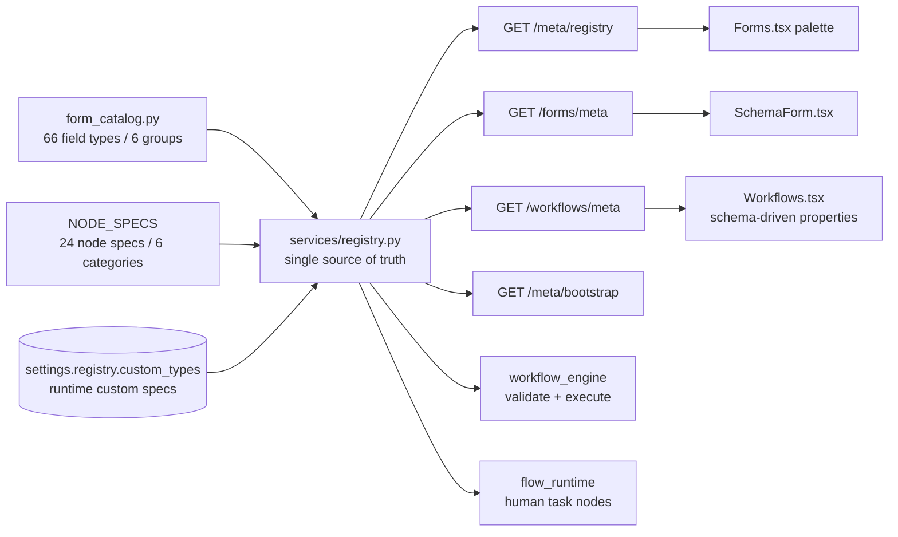

# Extensible Component / Node Registry, Full Agent Coverage & Skill Hubs

> 中文摘要：本文档描述 v5 扩展的四条主线：**声明式注册中心**（66 种表单组件 / 24 种工作流节点，带 `config_schema`，支持运行时注册自定义类型）、**权限驱动的智能体全能力覆盖**（55 个工具、10 个能力域、按当前角色过滤）、**MCP 服务与技能彻底分离**（新增 `skill:read` / `skill:write`）、以及**技能可视化编辑与 Skill Hub 体系**（3 个 Hub、13 个可搜索技能、跨 Hub 搜索 / 一键安装 / 远程索引降级）。所有数字均取自代码与 `/openapi.json`，并由 `backend/tests/smoke.py` 的 272 项断言验证。

| Field | Value |
| --- | --- |
| ID | `REG-001` |
| Status | Accepted |
| Version | 1.0 |
| Applicable release | v0.1.0 (v5 extension, 2026-11-10) |
| Related | `ARC-001`, `AI-001`, `API-001`, `DAT-001`, `MCP-001`, `ADR-0002`, `ADR-0012` |
| Source of truth | `backend/app/services/registry.py`, `services/mcp_tools.py`, `services/agent_admin_tools.py`, `services/skill_hubs.py`, `routers/meta.py`, `routers/skill_hubs.py` |

---

## 1. Motivation

Before v5, the form field catalogue, the workflow node catalogue, the designer property panels and the DAG validator each maintained their own list of supported types. Adding one component meant touching the Python catalogue, the validator, the REST metadata endpoint and two React renderers. Agents, meanwhile, could only reach 24 of the platform's capabilities, and Skills were still coupled to MCP servers through `mcp:read` / `mcp:write` permissions.

The v5 extension has four goals:

1. **One declarative registry** drives every consumer, and new types can be added at runtime without a deployment.
2. **Agents can do everything the signed-in user can do**, with the same RBAC boundary.
3. **MCP servers and Skills are independently managed entities** with separate permissions.
4. **Skills are visually inspectable/editable and discoverable from Hubs**.

---

## 2. Declarative registry

### 2.1 Form components

`form_catalog.entries()` supplies 66 field types across 6 groups (`basic`, `advanced`, `layout`, `domestic`, `system`, `custom`). `registry.form_component_specs(lang)` enriches each entry with a resolved `config_schema`: a common schema (`label`, `key`, `required`, `width`, `placeholder`, `visible_when`, `required_when`, …) plus capability-specific fields from `FORM_CAP_SCHEMA` (e.g. `options`, `formula`, `serial`, `validation`). The new `advanced` group adds `nps`, `segmented`, `daterange`, `timerange`, `slider_range`, `tags`, `markdown`, `code`, `gis`, `percent`, `currency`, `ai_autofill`, `custom`, and others; `COMPOSITE_TYPES` marks fields whose value is a structured object.

`SchemaForm.tsx` renders those types generically: `LAYOUT_TYPES` are structural, known advanced types get dedicated controls, and any unknown (including runtime-registered) type falls back to a plain input. This is what makes a new type consumable without a frontend change.

### 2.2 Workflow nodes

`NODE_SPECS` declares 24 node types in 6 categories (`control`, `task`, `logic`, `data`, `ai`, `integration`), each with an icon, colour, `runtime` (`auto` / `human` / `notification`) and a `config_schema` built from `ConfigField` descriptors (`text`, `textarea`, `code`, `number`, `boolean`, `select`, `json`, `list`, `form`). The 10 new types beyond the original 14 are `trigger`, `human_input`, `assign`, `script`, `data_write`, `db_query`, `ai_classify`, `skill`, `webhook` and `message`.

`NODE_EXECUTORS` maps automatic node types to pure Python handlers; `execute_node()` is the single dispatch point used by `workflow_engine._execute_node()`. Handlers are deliberately side-effect-light (HTTP / webhook / skill calls are simulated, `db_query` only permits `SELECT`, `script` uses a restricted `eval` with empty builtins). `human_node_types()` returns `{approval, cc, human_input}` — CC is a `notification`-runtime node that still creates a human task, so `flow_runtime` treats all three as long-running task nodes.

The workflow designer's `<NodeProperties>` is now a schema-driven renderer: it iterates `config_schema` and renders the matching control, so adding a node type requires no new JSX branch.

### 2.3 Runtime-extensible custom types

Custom specs are persisted in the `settings` table under `registry.custom_types` as `{"components": [...], "nodes": [...]}` — no schema migration and no restart. `register_custom()` normalizes each spec so every consumer sees the same shape (bilingual labels, `type`/`code`, `config`, `config_schema`, palette styling).

| Operation | Endpoint | Permission |
| --- | --- | --- |
| Read full registry | `GET /meta/registry?lang=en\|zh` | authenticated |
| Register component | `POST /meta/registry/components` | `form:write` |
| Register node | `POST /meta/registry/nodes` | `workflow:write` |
| Remove custom type | `DELETE /meta/registry/{kind}/{code}` | `form:write` / `workflow:write` |

A registered component immediately appears in `/forms/meta`, the designer palette and form validation; a registered node appears in `/workflows/meta` and passes DAG validation. Invalid codes are rejected with 400. All three operations are audit-logged.

---

## 3. Permission-driven full agent coverage

`mcp_tools.TOOL_SPECS` grew from 24 to **55** tools in three layers:

| Layer | Count | Examples |
| --- | --- | --- |
| Platform / business tools | 12 | `list_forms`, `submit_form`, `run_workflow`, `search_knowledge`, `get_stats` |
| Self-service / schema-action tools | 12 | `who_am_i`, `my_approvals`, `my_instances`, `my_capabilities`, `notification_prefs` |
| System administration tools (`agent_admin_tools.py`) | 31 | `list_mcp_servers`, `list_skills`, `search_skill_hub`, `add_skill_from_hub`, `manage_skill_hub`, `get_platform_settings`, `list_ai_providers`, `list_roles`, `query_audit_logs`, `list_registry`, `register_custom_type`, `create_form`, `create_workflow`, `list_kb_documents` |

Every spec carries a `permission` (or `None` for authenticated-only tools). `PERMISSION_MAP` and `_tool_allowed()` enforce that boundary in `list_tools(user=...)`, `call_tool()`, the MCP JSON-RPC `tools/list`, `GET /mcp/tools` and `GET /agents/meta/runtime`. The admin sees 55/55 tools; the seeded `operator` sees 35/55.

`capability_matrix(user)` groups the whole catalogue into 10 permission domains (`authenticated`, `form`, `workflow`, `knowledge`, `mcp`, `skill`, `settings`, `rbac`, `audit`, `dashboard`) with per-domain `available` / `total` counters. The agent studio's **Capabilities** tab visualises this matrix: an overall progress bar, expandable domain cards, permission badges and per-tool availability (green check vs. lock).

`agent_intents._system_plan()` routes natural-language administration requests to the matching tool, e.g. "我能做什么" → `my_capabilities`, "搜索技能 pdf" → `search_skill_hub`, "列出技能库" → `list_skill_hubs`, "组件目录" → `list_registry`, "有哪些角色" → `list_roles`, "新建表单 xxx" → `create_form`. `summarize_direct()` renders grounded natural-language answers for these tools.

---

## 4. MCP servers and Skills are separate

| Concern | MCP servers | Skills |
| --- | --- | --- |
| Router | `/mcp/servers` | `/skills`, `/skill-hubs` |
| Read / write permission | `mcp:read` / `mcp:write` | `skill:read` / `skill:write` |
| Entity | transport connection (`http`/`sse`/`stdio`) | installable capability package with files + manifest |
| Coupling | — | optional informational `server_id`; a `hub_id` / `source=hub:*` |

New permissions `skill:read` and `skill:write` were added to `PERMISSIONS` (28 total); `developer`, `operator`, `viewer` and `auditor` roles were updated accordingly. `seed.ensure_permission_upgrade()` idempotently adds the two permissions and re-grants them to existing roles, so older SQLite files upgrade in place. The Skills page no longer loads MCP servers to render, and the sidebar entry for `/skills` uses `skill:read`.

---

## 5. Visual skill editing

| Endpoint | Purpose |
| --- | --- |
| `GET /skills/{id}/preview` | Read-only visual preview: merged manifest, rendered `SKILL.md` / `README.md` HTML, declared tools and file inventory |
| `PUT /skills/{id}/manifest` | Save a structured manifest (name, version, description, capabilities, transport, entrypoint); mirrors to `manifest.json` |
| `PUT /skills/{id}/files/batch` | Save up to 50 files in one request |

`_md_html()` is a small XSS-safe Markdown renderer (escapes HTML before applying a limited set of block/inline rules). The Skills UI adds a **Visual** manifest dialog with capability editing, a file manager with **Code / Preview** toggle, and JSON pretty-printing. The Hub a skill came from is shown as `hub` metadata, not as a hard link.

---

## 6. Skill Hubs

`services/skill_hubs.py` manages skill registries (`skill_hubs` table):

| Hub | Kind | Behaviour |
| --- | --- | --- |
| `official` | builtin | Platform-curated skills, fully offline |
| `extended` | builtin | Marketplace with 8 additional skills (PDF, OCR, Excel, translate, email, Slack, charts, cron, …), fully offline |
| `community-remote` | remote | HTTP registry with index cache; disabled by default; falls back to cached index on failure |

The two built-in hubs expose **13 searchable skills** in 6 categories. `search_all(q, category)` merges results across enabled hubs and returns `errors` for any hub that failed, so an unreachable remote hub degrades gracefully instead of breaking discovery. Hub CRUD, enable/disable, sync and per-hub skill browsing are protected by `skill:read` / `skill:write`. Installing writes a real `mcp_skills` row with `source = hub:<code>`, `hub_id`, a generated manifest and the hub-provided file set; duplicate installs are rejected.

The `/hubs` page has **Discover** (search, category filter, one-click Add skill) and **Hub management** (create/edit/enable/sync/delete) tabs.

### Data model additions

- `skill_hubs`: `id`, `code` (unique), `name`, `description`, `kind`, `url`, `enabled`, `sync_interval_min`, `auth_config` JSON, `last_sync_at`, `index_cache` JSON, timestamps.
- `mcp_skills.hub_id` (nullable) added by lazy migration; `idx_skill_hubs_enabled` index.
- `settings.registry.custom_types` holds runtime custom component / node specs.

---

## 7. API quick reference (v5 additions)

| Method | Path | Permission |
| --- | --- | --- |
| GET | `/meta/registry` | authenticated |
| POST | `/meta/registry/components` | `form:write` |
| POST | `/meta/registry/nodes` | `workflow:write` |
| DELETE | `/meta/registry/{kind}/{code}` | `form:write` / `workflow:write` |
| GET | `/skill-hubs`, `/skill-hubs/search`, `/skill-hubs/stats` | `skill:read` |
| POST | `/skill-hubs` | `skill:write` |
| GET / PUT / DELETE | `/skill-hubs/{id}` | `skill:read` / `skill:write` |
| POST | `/skill-hubs/{id}/sync` | `skill:write` |
| GET | `/skill-hubs/{id}/skills`, `/skill-hubs/{id}/skills/{code}` | `skill:read` |
| POST | `/skill-hubs/{id}/install` | `skill:write` |
| GET | `/skills/{id}/preview` | `skill:read` |
| PUT | `/skills/{id}/manifest`, `/skills/{id}/files/batch` | `skill:write` |

`GET /meta/health` now reports `form_flow.custom_components`, `custom_nodes` and `hubs.configured` / `hubs.enabled`; `GET /meta/bootstrap` embeds `registry` and a permission-filtered capability matrix.

---

## 8. How to extend

**Add a built-in component**: add one entry to `form_catalog.py` (group, caps, defaults), extend `FORM_CAP_SCHEMA` if it introduces new properties, and add a rendering branch in `SchemaForm.tsx` only if the generic input is insufficient.

**Add a built-in node**: add a `NODE_SPECS` entry with its `config_schema`, add a `NODE_EXECUTORS` handler (or rely on `_ex_generic`), and set `runtime: "human"` if it should create an approval task. Validation, palette, property panel and runtime all pick it up automatically.

**Add a type at runtime**: `POST /meta/registry/components` or `/nodes` with `{"spec": {...}}`. No deployment; persisted across restarts.

**Add a hub**: `POST /skill-hubs` with `kind: "remote"` and a `url` serving an index; sync it, then search/install from the UI.

---

## 9. Verification

`backend/tests/smoke.py` contains **68 v5 assertions** (272 total, 0 failed):

- registry: 66 components / 24 nodes, `config_schema` on every spec, 6 node categories, human nodes, zh labels, bootstrap/health counters;
- custom types: register component → catalog → form validation → delete; register node → palette; invalid code rejected;
- node executors: one synchronous run covering 8 new nodes, context propagation (`script` → `total = 6`, `ai_classify` → `sales`);
- agent coverage: 55 tools, capability matrix (admin 55/55, operator 35/55), permission-filtered `/mcp/tools`, `my_capabilities` domain grouping, 4 system chat intents;
- separation: `skill:read` / `skill:write` in bootstrap, independent registries, `hub` metadata on skills;
- hubs: 3 hubs, cross-hub search, category filter, remote-hub degradation, Hub CRUD/sync, install, visual preview, manifest edit, batch file save, duplicate rejection and cleanup.

`ruff check app tests`, `pnpm typecheck`, `pnpm build`, i18n parity (929 en / 929 zh, 0 missing) and a 375px Playwright sweep over 14 routes (0px horizontal overflow on all) all pass. Screenshots: `skill-hubs.png`, `skill-editor.png`, `skill-preview.png`, `agent-capabilities.png`, `workflow-nodes.png`, `form-components.png`, `mobile-skill-hubs.png`, `mobile-agent-capabilities.png`.

## 10. Known limitations

- `script` nodes run a restricted `eval` (empty builtins) and are intended for trusted workflow authors, not untrusted input; full sandboxing would require a separate process.
- HTTP, webhook and skill nodes are simulated in the synchronous dry-run engine; real outbound calls are the responsibility of the long-running `flow_runtime` / external MCP bridge.
- Remote hubs require an index endpoint with a fixed JSON shape; there is no signature verification of downloaded skill packages yet.
- Custom node types use `_ex_generic` unless a matching executor is deployed; they are always validated as automatic nodes.
